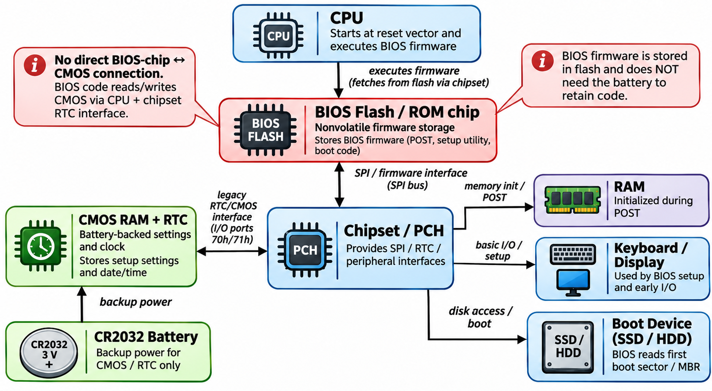
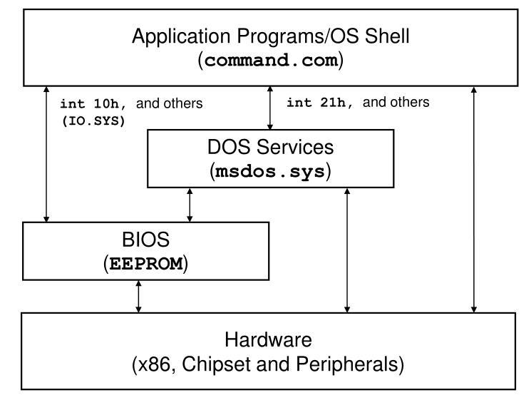
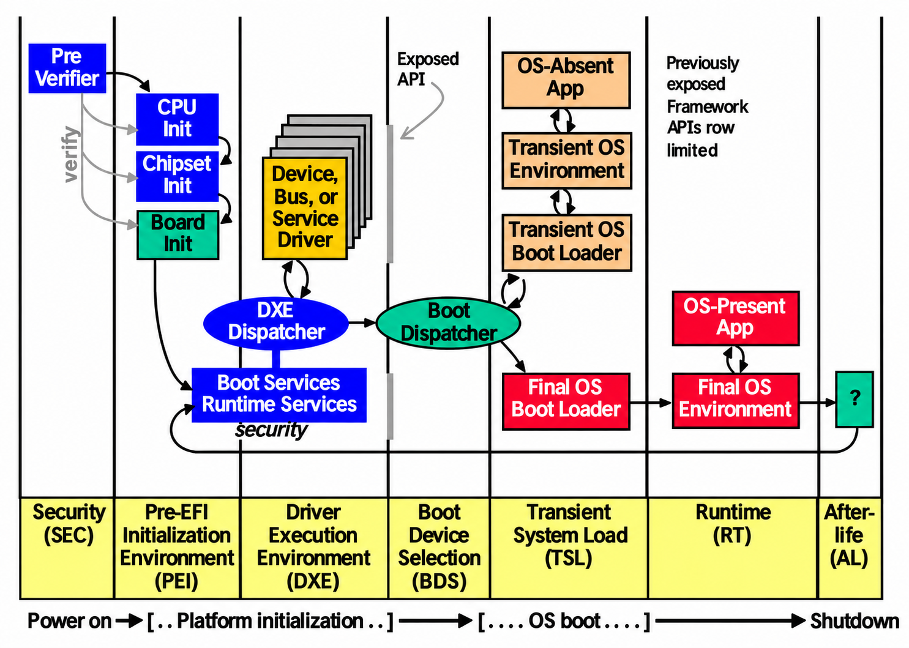

# Firmware: BIOS and UEFI

The [previous chapter](01_os_boot_process.md) introduced the boot sequence and showed that after the CPU resets, the first software it runs is **firmware** — code stored on a chip on the motherboard that initializes hardware and hands off to a bootloader. This chapter explains the two firmware standards that have powered PC boot for over four decades: **BIOS** and **UEFI**.

## What is Firmware?

Firmware is software permanently stored on a chip on the motherboard. Unlike an operating system, which resides on a hard drive or SSD, firmware is available immediately at power-on — the CPU can execute it directly from the chip without RAM or storage being initialized first.

On older systems, firmware was stored in a **ROM** (Read-Only Memory) chip. On modern systems, it resides in a **flash memory** chip soldered to the motherboard, which allows firmware updates. These chips are typically small 8-pin packages (8–32 MiB) that communicate with the CPU over an **SPI** (Serial Peripheral Interface) bus.

### Common Firmware Flash Chips

| Vendor              | Example Models           | Type |
|---------------------|--------------------------|------|
| **Winbond**         | W25Q64FV, W25Q128JV      | SPI NOR Flash |
| **Macronix (MXIC)** | MX25L6406E, MX25L12835F  | SPI NOR Flash |
| **SST (Microchip)** | SST25VF080B, SST49LF004B | SPI / LPC Flash |
| **GigaDevice**      | GD25Q64C, GD25B128E      | SPI NOR Flash |

### Common Firmware Vendors

The firmware code stored on the flash chip is developed by specialized vendors. These companies write both legacy BIOS and modern UEFI firmware. When you see a vendor name on the POST screen at startup (e.g., "American Megatrends"), it identifies who wrote the firmware:

| Vendor                        | Notes |
|-------------------------------|-------|
| **AMI (American Megatrends)** | Most common today — "Aptio" UEFI firmware |
| **Phoenix Technologies**      | Merged with Award Software; "SecureCore" UEFI |
| **Award Software**            | Classic BIOS era; now part of Phoenix |
| **Insyde Software**           | "InsydeH2O" — common on laptops (Lenovo, HP, etc.) |

## BIOS (Basic Input/Output System)

BIOS is the original firmware standard for IBM PC-compatible computers, dating back to the **IBM PC** in 1981. The name reflects its original purpose: providing a basic set of input/output services (keyboard, display, disk access) that operating systems and programs could call through software interrupts.

### How BIOS Works



When the CPU starts, it begins executing BIOS code from the reset vector. The BIOS then:

1. **Runs in 16-bit real mode** — the CPU's original 8086-compatible mode, with access to only 1 MiB of memory.

2. **Performs a Power-On Self-Test (POST)** — checks that the CPU, RAM, and essential hardware are functional. Errors are reported through beep codes or on-screen messages.

3. **Initializes hardware** — configures memory controllers, buses, and detects peripherals (keyboard, display, storage controllers).

4. **Reads CMOS settings** — retrieves user-configurable data such as the boot order from a small battery-backed memory (CMOS). On older systems, this was a separate chip (e.g., the MC146818 RTC); on modern systems, it is integrated into the PCH but accessed through the same legacy I/O ports (`0x70`/`0x71`). The diagram above shows CMOS separately for clarity. See [Settings Storage](#settings-storage-cmos-and-nvram) for details.

5. **Searches for a bootable device** — checks each device in the configured boot order for a valid boot signature (`0x55AA` in the last two bytes of the first sector).

6. **Loads the bootloader** — copies the first 512-byte sector (the MBR) from the boot device into RAM at address `0x7C00` and jumps to it.

### BIOS Services (Software Interrupts)

BIOS provides a set of services to early boot code through **software interrupts** — a mechanism where a program triggers a numbered interrupt (e.g., `INT 10h`) and the BIOS executes a corresponding handler routine:

| Interrupt | Service |
|-----------|---------|
| `INT 10h` | Video — text output, cursor positioning, graphics mode |
| `INT 13h` | Disk — read/write sectors, get drive parameters |
| `INT 14h` | Serial port communication |
| `INT 15h` | System — memory map, power management (APM), extended memory |
| `INT 16h` | Keyboard — read keystrokes, check keyboard status |

These interrupt services are only available in real mode. Once the OS switches to protected or long mode, it must use its own device drivers instead.



The diagram above shows how BIOS fits into the classic DOS-era system architecture as a series of layers:

- **Hardware** — the physical CPU, chipset, and peripherals.
- **BIOS** — sits directly on top of hardware and provides low-level services through interrupts (`INT 10h` for video, `INT 13h` for disk, etc.).
- **DOS Services** (`msdos.sys`) — a higher-level layer that provides file and system operations through `INT 21h`. DOS internally calls BIOS interrupts to access hardware.
- **Applications** (`command.com`, user programs) — can call DOS services (`INT 21h`) for convenience, or call BIOS interrupts directly for low-level hardware access.

This layered design meant programs did not need to know the details of each specific device — BIOS abstracted the hardware away behind a standard interrupt interface.

### BIOS Limitations

- **16-bit real mode only** — limited to 1 MiB of addressable memory during boot.
- **MBR-based booting** — supports only MBR partition tables, which are limited to 2 TiB disks and four primary partitions.
- **No filesystem awareness** — loads raw sectors; cannot read files from a partition.
- **No security model** — any code in the MBR runs without verification.
- **Slow initialization** — initializes devices sequentially.
- **Limited extensibility** — adding support for new hardware requires option ROMs.

## UEFI (Unified Extensible Firmware Interface)

UEFI is the modern replacement for BIOS, designed to overcome its limitations. It began as Intel's **EFI** (Extensible Firmware Interface) specification in the mid-1990s, originally developed for the Itanium platform. In 2005, Intel transferred stewardship to the **UEFI Forum** — an industry consortium including AMD, Apple, Dell, HP, Lenovo, and Microsoft — and the specification was renamed UEFI.

> **EFI vs UEFI:** EFI refers to Intel's original specification (versions 1.x). UEFI refers to the unified specification maintained by the UEFI Forum (versions 2.x and later). In practice, the terms are often used interchangeably — when people say "EFI" today, they usually mean UEFI.

### How UEFI Works

On x86, the CPU still resets into 16-bit real mode (this is a hardware constraint — see [CPU Reset](01_os_boot_process.md#cpu-power-on-and-reset)). However, unlike BIOS which remains in real mode throughout its operation, UEFI firmware transitions to **32-bit protected mode or 64-bit long mode** almost immediately during the SEC phase and operates in that mode for the rest of the boot process, giving it access to the full memory address space.



The boot process follows a series of phases defined by the **Platform Initialization (PI)** specification:

1. **SEC (Security Phase)** — the CPU begins executing from the firmware flash chip at the reset vector. On x86, the very first instructions transition the CPU from 16-bit real mode to 32-bit flat mode (or 64-bit long mode). SEC then establishes a temporary memory store — typically by configuring the CPU cache to behave as linear RAM (known as **Cache-as-RAM** or **CAR**, operating in no-eviction mode since main memory is not yet available). SEC serves as the **root of trust** for the platform — on systems with Secure Boot or verified boot, this is where firmware integrity verification begins, though the extent of verification is platform-dependent.

2. **PEI (Pre-EFI Initialization)** — initializes the CPU, chipset, and permanent DRAM. This phase runs using the temporary memory (CAR) that SEC established and passed via the `EFI_SEC_PEI_HAND_OFF` structure. PEI Initialization Modules (PEIMs) detect and configure DRAM, then report the permanent memory layout through Hand-Off Blocks (HOBs) before passing control to DXE.

3. **DXE (Driver Execution Environment)** — now that permanent RAM is available, this phase loads UEFI drivers for storage, networking, display, and other devices. It produces two sets of services: **Boot Services** (available only during boot, freed after the OS takes over) and **Runtime Services** (persist after boot so the OS can access firmware features like NVRAM variables).

4. **BDS (Boot Device Selection)** — reads boot entries from NVRAM, displays a boot menu if needed, and selects a boot target.

5. **Loads the bootloader** — locates and executes a `.efi` bootloader. For disk-based boot, this is loaded from the **EFI System Partition (ESP)**. For network boot, the firmware uses **PXE** (DHCP + TFTP) or **HTTP Boot** to download the bootloader from a server — no ESP is involved.

### EFI System Partition (ESP)

The ESP is a small FAT32-formatted partition (typically 100–500 MiB) that stores bootloader files. Unlike BIOS, which loads raw sectors, UEFI firmware has a built-in FAT32 filesystem driver and reads bootloader files by path:

| Bootloader           | Typical Path on ESP |
|----------------------|---------------------|
| Default (fallback)   | `\EFI\BOOT\BOOTX64.EFI` |
| Windows Boot Manager | `\EFI\Microsoft\Boot\bootmgfw.efi` |
| Linux GRUB2          | `\EFI\ubuntu\grubx64.efi` |
| systemd-boot         | `\EFI\systemd\systemd-bootx64.efi` |

> For details on the GPT partition table used with UEFI, see [GPT](https://github.com/ManiAm/storage-and-file-systems/blob/master/docs/05_gpt.md) in the Disk Storage project.

### UEFI Boot Manager

UEFI includes a built-in **boot manager** that maintains an ordered list of boot entries stored in NVRAM. Each entry specifies a bootloader path on the ESP. On Linux, the `efibootmgr` utility can view and modify these entries:

```
$ efibootmgr -v
BootCurrent: 0001
BootOrder: 0001,0000,0003
Boot0000* Windows Boot Manager  HD(1,GPT,...)/File(\EFI\Microsoft\Boot\bootmgfw.efi)
Boot0001* ubuntu                HD(1,GPT,...)/File(\EFI\ubuntu\shimx64.efi)
Boot0003* PXE Network Boot      PciRoot(0x0)/Pci(0x1c,0x0)/...
```

Unlike BIOS, which only checks devices in order until it finds a bootable sector, UEFI can directly target a specific bootloader file on a specific partition.

### Secure Boot

Secure Boot is a UEFI feature that ensures only **signed** (cryptographically verified) bootloaders and drivers can execute during the boot process. It protects against bootkits and rootkits — malware that embeds itself in the boot chain before the OS can detect it.

How it works:

1. The motherboard ships with a set of **trusted keys** in NVRAM (Platform Key, Key Exchange Keys, and a signature database).
2. When UEFI loads a `.efi` binary, it checks its digital signature against the trusted keys.
3. If the signature is valid, execution proceeds. If not, the binary is rejected.

Microsoft requires Secure Boot support for Windows 8+ hardware certification. Linux distributions handle Secure Boot through **shim** — a small first-stage bootloader signed by Microsoft that then loads the distribution's own signed GRUB or systemd-boot.


## Firmware + Partitioning Combinations

The firmware (BIOS or UEFI) and the partitioning scheme (MBR or GPT) are independent choices. Together they form four possible combinations:

|                      | **MBR partitioning**                     | **GPT partitioning**                    |
|----------------------|------------------------------------------|-----------------------------------------|
| **BIOS firmware**    | ✅ BIOS + MBR — the classic (1981–~2012) | ⚠️ BIOS + GPT — transitional           |
| **UEFI firmware**    | ⚠️ UEFI + MBR — transitional (via CSM)   | ✅ UEFI + GPT — the modern standard    |

**BIOS + MBR** is the original pairing. The BIOS loads the MBR (sector 0), which contains the bootloader and a partition table limited to 2 TiB and four primary entries. This is the combination examined in the [Rufus](04_bootloader_rufus.md) and [Syslinux](05_bootloader_syslinux.md) bootloader chapters.

**UEFI + GPT** is the modern standard. The UEFI firmware reads the GPT partition table, locates the EFI System Partition, and loads a `.efi` bootloader directly from the filesystem. No 2 TiB limit, no four-partition limit, and Secure Boot is available.

The two **transitional** combinations bridge the gap:

**BIOS + GPT** — for BIOS machines that need GPT (e.g., disks larger than 2 TiB). GPT includes a [Protective MBR](https://github.com/ManiAm/storage-and-file-systems/blob/master/docs/05_gpt.md#backward-compatibility-with-mbr) in sector 0 that the BIOS can boot from. Common on Linux servers and VMs with large disks. See [BIOS Boot Partition](06_bootloader_grub.md#gpt-case-bios-boot-partition) in the GRUB chapter for how GRUB handles this case.

**UEFI + MBR** — for UEFI machines that need to boot old MBR-partitioned disks. This works through **CSM** (see below). The firmware emulates a legacy BIOS, loads the MBR at `0x7C00`, and the classic BIOS boot path runs as if on real BIOS hardware.

### Compatibility Support Module (CSM)

CSM is a component within UEFI firmware that **emulates legacy BIOS behavior**, enabling the UEFI + MBR transitional combination described above. When CSM is enabled:

- **Legacy boot** — loads MBR boot code (sector 0) into `0x7C00` and executes it in 16-bit real mode.
- **BIOS interrupt services** — provides `INT 13h` (disk), `INT 10h` (video), and other handlers that legacy bootloaders depend on.
- **Legacy option ROMs** — runs older hardware initialization code (e.g., for graphics cards) that was written for BIOS, not UEFI.

| Scenario                                               | CSM Required? |
|--------------------------------------------------------|---------------|
| Booting a legacy OS (e.g., Windows 7) from an MBR disk | Yes           |
| Booting a modern OS from a GPT disk in UEFI mode       | No            |
| Using a graphics card with no UEFI-compatible ROM      | Yes           |
| Using Secure Boot                                      | No (CSM must be **disabled**) |

**CSM is being phased out.** Intel removed CSM support starting with 12th-generation (Alder Lake) platforms, and most manufacturers now ship firmware with CSM disabled by default or removed entirely. Windows 11 requires UEFI + GPT + Secure Boot — no CSM.

> **UEFI Class definitions:**
> - **Class 0–1** — Legacy BIOS only (no UEFI).
> - **Class 2** — UEFI firmware **with** CSM (can boot both UEFI and legacy).
> - **Class 3** — UEFI firmware **without** CSM (UEFI boot only).
> - **Class 3+** — Class 3 with Secure Boot enabled.


## Settings Storage: CMOS and NVRAM

Both BIOS and UEFI need a place to store user-configurable settings that persist across reboots. Typical settings include:

- **Boot order** — which devices to try first (e.g., USB → SSD → Network)
- **Date and time** — system clock maintained while the PC is off
- **CPU settings** — overclocking, virtualization (VT-x), hyper-threading
- **Memory settings** — XMP profiles, timing, voltage
- **Peripheral configuration** — enabling/disabling onboard audio, LAN, USB ports
- **Security settings** — BIOS/UEFI password, Secure Boot keys (UEFI only)
- **Power management** — wake-on-LAN, power-on after AC loss
- **Fan and thermal profiles** — fan curves, temperature thresholds

Each firmware type uses a different storage approach.

### CMOS (BIOS)

On BIOS systems, settings are stored in a small **CMOS** (Complementary Metal-Oxide-Semiconductor) memory chip — a tiny amount of volatile **SRAM** (typically just 128–256 bytes). Because CMOS is volatile, it requires a **CR2032 coin-cell battery** on the motherboard to stay powered when the PC is off. If the battery dies, the CMOS loses its data and settings revert to factory defaults.

Historically, CMOS memory was integrated into the **Real-Time Clock (RTC)** chip — the same chip that keeps the system clock running while the PC is off. On modern systems, both the RTC and CMOS are integrated into the **PCH** (Platform Controller Hub) chipset, but the battery is still required.

#### Common RTC/CMOS Chips

| Chip | Vendor | Notes |
|------|--------|-------|
| **MC146818** | Motorola | The original — used in the IBM PC/AT (1984). Defined the CMOS register layout (`0x70`/`0x71` I/O ports) still emulated by every modern chipset |
| **DS12885 / DS12887** | Dallas Semiconductor | Popular successors with built-in battery and crystal oscillator |
| **PCF8523** | NXP | Modern I²C-based RTC used in embedded systems |

### NVRAM (UEFI)

On UEFI systems, settings are stored in **NVRAM** (Non-Volatile RAM) — flash memory on the motherboard that retains data without a battery. NVRAM stores UEFI variables including boot entries, Secure Boot keys, and firmware configuration. Unlike CMOS, NVRAM can hold significantly more data and does not depend on a battery for persistence.

## SMBIOS (System Management BIOS)

**SMBIOS** is a specification that defines a standard way for firmware to expose **hardware inventory and system information** to the operating system through structured data tables. Despite having "BIOS" in its name, SMBIOS is used by both legacy BIOS and modern UEFI systems — the name is simply historical.

The specification is maintained by the **DMTF** (Distributed Management Task Force), independent of the UEFI Forum. The current version is [DSP0134 v3.10.0](https://www.dmtf.org/standards/smbios).

### What SMBIOS Provides

SMBIOS tables describe the system's hardware configuration in a machine-readable format. The specification defines structure types 0–46 (plus type 126 for inactive entries and type 127 for end-of-table), with types 128–255 reserved for vendor-specific data. The most commonly referenced types are:

| Type    | Structure Name              | Information |
|---------|-----------------------------|-------------|
| Type 0  | Platform Firmware Information | Firmware vendor, version, and release date |
| Type 1  | System Information          | System manufacturer, product name, serial number, UUID |
| Type 2  | Baseboard Information       | Motherboard manufacturer, model, and serial number |
| Type 3  | System Enclosure / Chassis  | Chassis type (desktop, laptop, rack server), manufacturer |
| Type 4  | Processor Information       | CPU type, speed, core count, and socket |
| Type 7  | Cache Information           | L1/L2/L3 cache size, associativity, and error correction |
| Type 8  | Port Connector Information  | Internal/external port connectors (USB, serial, audio, network) |
| Type 9  | System Slots                | PCI/PCIe expansion slot type, width, usage, and length |
| Type 16 | Physical Memory Array       | Maximum memory capacity, number of slots, error correction type |
| Type 17 | Memory Device               | DIMM size, speed, type, and slot location |

### How the OS Accesses SMBIOS Data

The mechanism differs depending on the firmware type:

- On **BIOS** systems — SMBIOS tables are placed in memory, and the OS finds them by scanning a known address range (`0xF0000`–`0xFFFFF`) for the `_SM_` anchor string.

- On **UEFI** systems — SMBIOS tables are passed to the OS through the **UEFI System Configuration Table**, a cleaner and more reliable mechanism.

On Linux, the `dmidecode` utility reads SMBIOS data. Running it without a type filter shows all structures; the `-t` flag filters by type keyword or number:

```
$ sudo dmidecode -t bios
# dmidecode 3.5
Getting SMBIOS data from sysfs.
SMBIOS 2.8 present.

Handle 0x0000, DMI type 0, 24 bytes
BIOS Information
        Vendor: Dell Inc.
        Version: A34
        Release Date: 10/19/2020
        Address: 0xF0000
        ROM Size: 16 MB
        Characteristics:
                PCI is supported
                BIOS is upgradeable
                ACPI is supported
                USB legacy is supported
                UEFI is supported
        BIOS Revision: 65.34
```

Other useful queries:

```
$ sudo dmidecode -t bios         # Type 0  — firmware vendor, version, release date
$ sudo dmidecode -t system       # Type 1  — manufacturer, product, serial, UUID
$ sudo dmidecode -t baseboard    # Type 2  — motherboard model and serial
$ sudo dmidecode -t chassis      # Type 3  — chassis type, manufacturer
$ sudo dmidecode -t processor    # Type 4  — CPU model, speed, core count
$ sudo dmidecode -t cache        # Type 7  — L1/L2/L3 cache size and associativity
$ sudo dmidecode -t connector    # Type 8  — port connectors (USB, serial, audio, etc.)
$ sudo dmidecode -t slot         # Type 9  — PCI/PCIe expansion slots
$ sudo dmidecode -t memory       # Type 16 + 17 — memory array and DIMM details
```

> **Note:** SMBIOS is about hardware inventory reporting, not the boot process itself. Firmware populates the tables during initialization, and the OS reads them after it starts.

## BIOS vs UEFI

| Feature | BIOS | UEFI |
|---------|------|------|
| Year introduced | 1981 | 2005 (EFI: ~1998) |
| CPU mode at boot | 16-bit real mode | Transitions to 32-bit or 64-bit in SEC |
| Addressable memory | 1 MiB | Full address space |
| Partition table | MBR (max 2 TiB, 4 partitions) | GPT (max 9.4 ZiB, 128+ partitions) |
| Boot mechanism | Loads raw 512-byte sector (MBR) | Reads `.efi` file from ESP, or via PXE/HTTP Boot |
| Filesystem awareness | None | FAT32 (built-in) |
| Secure Boot | No | Yes |
| Boot manager | None (sequential device check) | Built-in (NVRAM boot entries) |
| Driver model | Option ROMs (16-bit) | UEFI drivers (32/64-bit, portable) |
| User interface | Text-only setup | Graphical setup with mouse support |
| Network boot | PXE (basic) | PXE + HTTP Boot |
| Firmware updates | Vendor-specific tools | Standardized capsule update mechanism |

---

[← Previous: OS Boot Process](01_os_boot_process.md) | [Next: Bootloaders →](03_bootloaders.md)
