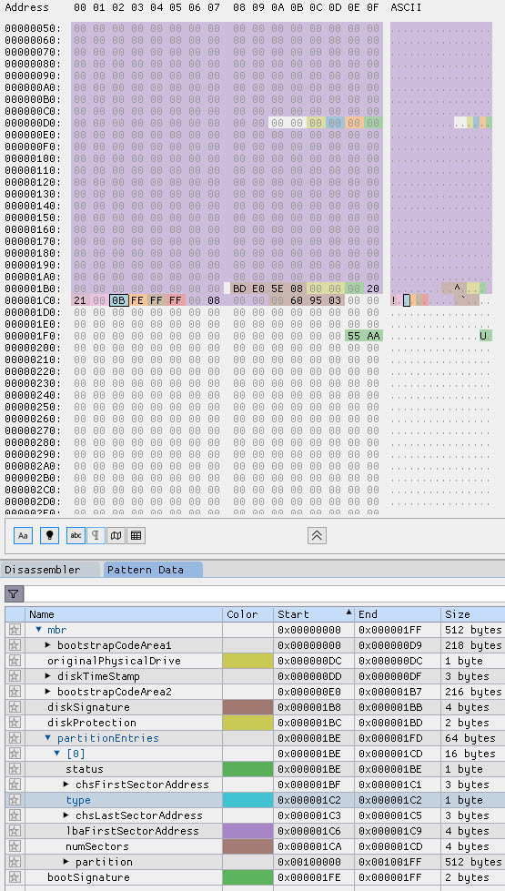
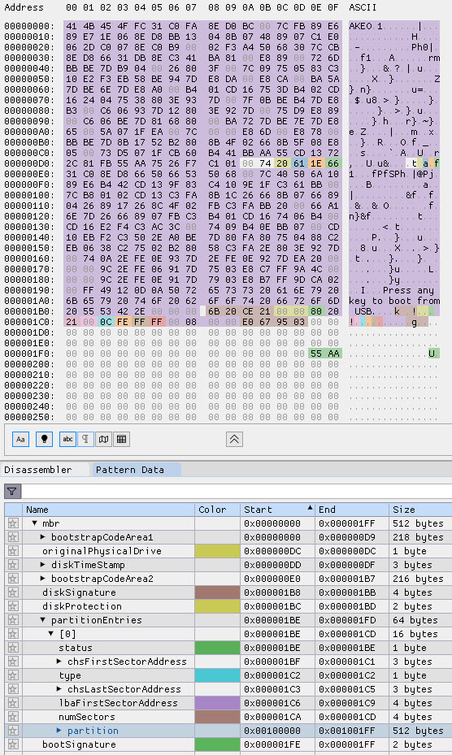
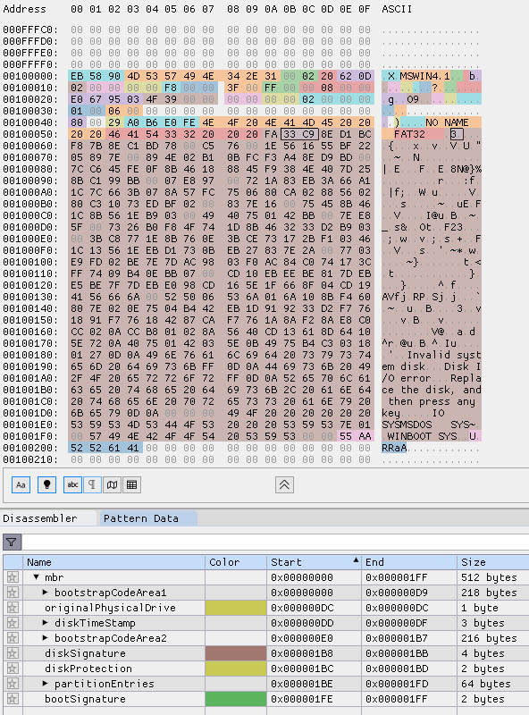

# Bootloader: Rufus

The [previous chapter](03_bootloaders.md) cataloged the major bootloader software. But what does a bootloader actually _do_ once it runs? This chapter answers that question hands-on: we examine a real MBR and FAT32 boot sector on a USB drive, trace the MS-DOS boot path through actual code, and explain every step from power-on to operating system handoff. The [next chapter](05_bootloader_syslinux.md) then examines the Syslinux MBR bootloader — a general-purpose alternative with extended partition support and runtime code patching.

**Key terms used in this chapter:**

| Term | Full Name                | Role |
|------|--------------------------|------|
| MBR  | Master Boot Record       | First 512 bytes of the disk — contains boot code (446 bytes) + partition table (64 bytes) + signature (2 bytes) |
| VBR  | Volume Boot Record       | First sector of a partition — contains the filesystem-specific bootloader that loads the OS |
| PBR  | Partition Boot Record    | Another name for VBR |
| CHS  | Cylinder-Head-Sector     | Legacy disk addressing scheme used by BIOS INT 13h |
| LBA  | Logical Block Addressing | Modern linear sector addressing (sector 0, 1, 2, …) |

> For a deeper look at MBR/GPT partitioning, FAT32, and other filesystem internals, see the companion repository: [Storage and File Systems](https://github.com/ManiAm/storage-and-file-systems).

## Investigating a Blank MBR

Before looking at a working bootloader, it helps to see what an MBR looks like _before_ any bootloader is installed — just a partition table and no executable code.

**Setup:** A 32 GB USB flash drive was partitioned (one primary FAT32 partition) using EaseUS Partition Manager, then opened in the [ImHex](https://imhex.werwolv.net/) hex editor as a raw disk (requires administrator privileges).



Notice that the primary partition is not marked active and the boot code area (first 446 bytes) is empty. The BIOS would not be able to boot from this disk.

## Making the Drive Bootable with Rufus

[Rufus](https://rufus.ie/) is a utility for creating bootable USB drives. When you select **MS-DOS** as the boot option, Rufus:

1. Writes an MBR bootloader into the first 446 bytes of the disk.
2. Marks the primary partition as active (sets byte 0 of the partition entry to `0x80`).
3. Writes a FAT32 VBR (boot sector) into the first sector of the partition.
4. Copies the MS-DOS system files (`IO.SYS`, `MSDOS.SYS`, `COMMAND.COM`) to the partition.

The result is a drive that can boot on any system with BIOS or Legacy/CSM mode.

> **MS-DOS vs. FreeDOS:** Rufus also offers a FreeDOS option. FreeDOS is a free, open-source, actively maintained OS that is fully compatible with MS-DOS. Both produce the same MBR and VBR structure — only the OS files on the partition differ.

## MBR Bootloader — How It Works

After creating the bootable drive, we can open it in ImHex to inspect the MBR:



The MBR bootloader code used by Rufus is open-source:
[rufus/res/mbr/mbr.S](https://github.com/pbatard/rufus/blob/master/res/mbr/mbr.S)

### Boot Flow Overview

When the BIOS finishes POST, it loads the MBR (512 bytes) from the USB disk into memory at address `0x7C00` and jumps to it. The Rufus MBR bootloader then:

1. **Relocates itself** — copies itself to another memory location to free up `0x7C00`, preserving its own partition table in the copy.
2. **Reads the hard disk's MBR** — asks the BIOS (via INT 13h) to load sector 0 of drive `0x81` (the internal hard disk) into `0:0x7C00`. If the read fails, it skips straight to booting from USB.
3. **Scans the hard disk's partition table** for an active partition — to determine whether there is an alternative boot option.
4. **Prompts the user** to press a key (with a timeout).
5. **Loads the VBR** of the chosen disk's active partition into `0x7C00`.
6. **Jumps to the VBR** to continue booting.

The following sections walk through each step using the actual Rufus MBR source code.

### Step 1 — Self-Relocation

The MBR's very first job is to copy itself out of `0x7C00` to free that address for the VBR it will load later. The Rufus MBR steals 1 KB from the top of conventional memory and adjusts the segment so that all code offsets remain `0x7C00`-based:

> **Segment:offset notation:** In x86 real mode, memory is addressed as `segment:offset`, where the physical address = segment × 16 + offset. For example, `0:0x7C00` means segment 0, offset `0x7C00`, giving physical address `0x7C00`. This notation appears throughout the MBR and VBR code.

```asm
    cld                    # clear direction flag (for forward copy)
    xor  ax, ax
    cli                    # disable interrupts during stack setup
    mov  ss, ax            # SS = 0
    mov  sp, MBR_ADDR      # SP = 0x7C00 (stack grows downward)
    sti
    mov  si, sp            # SI = 0x7C00 (source offset)
    mov  di, sp            # DI = 0x7C00 (same offset in destination segment)
    push ds                # save original DS and ES on the stack —
    push es                #   restored later in Step 6 before jumping to VBR
    mov  ds, ax            # DS = 0 (source segment)

    # Steal 1 KB from the top of conventional memory
    mov  bx, 0x0413
    mov  ax, ds:[bx]       # BIOS data area: conventional memory size (KB)
    dec  ax                # reserve 1 KB for the relocated copy
    mov  ds:[bx], ax       # update BIOS memory map
    shl  ax, 6             # KB → segment address (× 64)
    sub  ax, MBR_ADDR>>4   # adjust so offsets remain 0x7C00-based
    mov  es, ax            # ES = destination segment

    mov  cx, MBR_SIZE      # 512 bytes
    rep  movsb             # copy MBR: 0:0x7C00 → new_seg:0x7C00
    push ax                # push new CS (destination segment)
    push offset cont       # push new IP
    retf                   # far return → jump to relocated copy

cont:
    mov  ds, ax            # DS = relocated segment (matches new CS)
```

The `sub ax, MBR_ADDR>>4` line is the key trick: it adjusts the destination segment so that all `0x7C00`-based symbol offsets work identically in the relocated copy. After `retf` jumps to the copy, `DS` points to the relocated segment (preserving the USB drive's partition table), while `ES` will be set to 0 in the next step — creating the segment distinction that lets the bootloader access both partition tables simultaneously.

### Step 2 — Read the Hard Disk's MBR

With relocation complete, the bootloader asks the BIOS to read sector 0 (the MBR) of the second hard disk (drive `0x81` — the internal drive) into the now-free `0:0x7C00`. The bootloader cannot access the disk hardware directly — it must go through **BIOS INT 13h** (disk services), which handles the actual I/O:

```asm
    xor  ebx, ebx       # LBA sector 0 (the MBR)
    mov  es, bx          # ES = segment 0 (destination: 0:0x7C00)
    inc  cx              # CHS sector 1 (sectors are 1-indexed)
    mov  dx, 0x0081      # DL = drive 0x81 (second hard disk), DH = head 0
    call read_sector     # → BIOS INT 13h performs the actual disk read
    jb   boot_usb        # read failed → skip to booting from USB
```

If the hard disk is missing or unreadable, INT 13h returns an error and the bootloader falls through to `boot_usb`, booting from the USB drive directly — no prompt needed.

### Step 3 — Scan the Hard Disk's Partition Table

If the read succeeds, the bootloader iterates through the four 16-byte partition entries in the hard disk's MBR (now at `0:0x7C00`), checking the first byte of each entry:

- `0x80` or higher → **active** (bootable)
- `0x00` → inactive (skip)
- `0x01`–`0x7F` → **invalid** (treat as no bootable partition)

```asm
PT_MAX        = 0x04       # Maximum partition entries
PT_ENTRY_SIZE = 0x10       # Size of each entry (16 bytes)

read_success:
    mov  bx, offset partition_table   # BX = offset of partition table within the MBR
    mov  cx, PT_MAX

check_table:
    cmpb es:[bx], 0x00      # ES = 0 → reads from the hard disk's MBR at 0:0x7C00
    jl   found_active        # 0x80 or greater → active
    jnz  invalid_table       # 0x01–0x7F → invalid
    add  bx, PT_ENTRY_SIZE   # next entry
    loop check_table
```

Because `ES` = 0 and the hard disk's MBR sits at `0:0x7C00`, `es:[bx]` reads from the hard disk's partition table. Later, `ds:[bx]` reads from the relocated segment — the USB drive's own partition table. The same offset works for both because the segment trick from Step 1 keeps all addresses `0x7C00`-based.

### Step 4 — Prompt the User with a Timeout

If an active partition is found on the hard disk, the bootloader knows there is a bootable OS installed. It displays a prompt and waits for a keypress, using the CMOS Real-Time Clock (RTC) interrupt to implement a countdown timer:

```asm
prompt_string:  .string "\r\nPress any key to boot from USB."

found_active:
    mov  si, offset prompt_string
    call print_string
    call flush_keyboard

set_rtc_int_vect:
    mov  dx, offset rtc_interrupt
    mov  si, offset rtc_interrupt_org
    call set_int_vect
```

The wait loop checks for keyboard input using BIOS INT 16h:

```asm
wait_for_keyboard:
    mov  ah, 0x01
    int  0x16               # CHECK KEYBOARD BUFFER (non-blocking)
    jnz  boot_usb_rem_rtc   # key pressed → boot from USB
    mov  ah, 0x02
    int  0x16               # GET SHIFT KEY STATUS
    and  al, 0x04           # check Ctrl key
    jnz  boot_usb           # Ctrl held → boot from USB immediately
    cmpb ds:counter_dot, 0x00
    jg   check_timeout
```

The loop checks two types of input: any key in the keyboard buffer, or the **Ctrl** key being held down. Either one triggers a USB boot — Ctrl provides a way to force USB boot at any point during the countdown without waiting for the prompt to finish.

For reference, `print_string` writes characters one at a time to the screen via BIOS INT 10h (Teletype output):

```asm
print_string:
    lodsb
    cmp  al, 0x00
    jz   0f
    mov  ah, 0x0e           # Teletype output function
    mov  bx, 0x0007         # BH = page 0, BL = light gray
    int  0x10               # VIDEO — WRITE CHARACTER AND ADVANCE CURSOR
    jmp  print_string
0:  ret
```

### Step 5 — Boot Decision

The boot decision has two paths that **both converge** at `boot_drive`:

**Path A — Timeout (no key pressed):** boot from the internal hard disk. The code sets up a disk-swap mapping (`0x80` ↔ `0x81`) and falls through directly into `boot_drive`:

```asm
boot_fixed_disk:
    call restore_rtc_vect           # remove RTC override
    movb ds:partition_table, 0x81   # target disk to swap with 0x80
    push 0x0080
                                    # falls through to boot_drive ↓
```

> **Why disk-swap?** Most operating systems assume they are booting from drive `0x80` (the BIOS primary disk). Since the USB is currently `0x80` and the hard disk is `0x81`, the bootloader installs an INT 13h hook (in Step 6) that transparently swaps drive numbers on every disk call, making the hard disk appear as `0x80` to the OS.

**Path B — Key pressed:** boot from the USB drive. The code reads the USB drive's own partition table (via `ds:[bx]`, which points to the **relocated** MBR copy — not the hard disk data at `0:0x7C00`) and loads the VBR of the USB's active partition:

```asm
boot_usb_rem_rtc:
    call restore_rtc_vect

boot_usb:
    call flush_keyboard
    mov  bx, offset partition_table
    mov  dx, ds:[bx]        # read from DS (relocated segment) = USB's partition table
    push dx
    mov  dl, 0x80            # disk number for USB
    mov  cx, ds:[bx+2]      # CHS values from USB's partition entry
    mov  ebx, ds:[bx+8]     # LBA of USB partition start (modifies BX — must come last)
    call read_sector
    jnb  boot_drive          # success → converge at boot_drive ↓
    pop  es                  # read failed — return to BIOS
    pop  ds
    retf
```

### Step 6 — Jump to the VBR

Both paths converge here. The VBR has been loaded into `0x7C00`. The bootloader hooks **INT 13h** (BIOS disk services) with a custom handler that performs the drive-number swap from Step 5, then restores the original segment registers (saved in Step 1) and jumps:

```asm
MBR_ADDR = 0x7C00

boot_drive:                          # ← both paths arrive here
    mov  dx, offset dsk_interrupt    # hook INT 13h with our disk-swap handler
    mov  si, offset dsk_interrupt_org
    call set_int_vect

    pop  dx                  # restore disk index for VBR
    pop  es                  # restore ES (saved in Step 1)
    pop  ds                  # restore DS (saved in Step 1)
    jmp  0:MBR_ADDR          # transfer control to VBR at 0x7C00
```

From this point on, the MBR's job is done. The VBR takes over and begins the filesystem-specific boot process.

### MBR Boot Summary

```
 BIOS loads USB MBR → 0x7C00
       │
       ▼
 MBR relocates itself (preserves USB partition table)
       │
       ▼
 Ask BIOS to read hard disk's MBR into 0:0x7C00
       │
       ├─ read failed → boot from USB directly
       │
       ▼
 Scan hard disk's partition table
       │
       ├─ no active partition → boot from USB directly
       │
       ▼
 Active partition found → prompt user
       │
       ├─ key pressed → load VBR from USB (ds:[bx])
       │                         │
       └─ timeout → load VBR from hard disk
                          │
                          ▼
                    boot_drive (both paths converge)
                          │
                          ▼
                    VBR at 0x7C00 → OS boot continues
```

> **Why 0x7C00?** This address (31,744 in decimal) was established by IBM in 1981 for the original PC. It sits above the interrupt vector table (`0x0000`–`0x03FF`) and BIOS data area (`0x0400`–`0x04FF`), and below the usable conventional memory. It became a de facto standard that all x86 BIOS implementations follow.

## FAT32 Boot Sector (VBR)

Once the MBR hands off to the VBR, we are inside the boot sector of the [FAT32](https://github.com/ManiAm/storage-and-file-systems/blob/master/docs/11_fat_filesystem.md) partition. This code was written during formatting — either by the OS installer, Rufus, or a disk utility.

The VBR's job is to begin the OS boot process. Because a single 512-byte sector cannot hold enough code to navigate the FAT32 filesystem, the VBR:

1. Parses the FAT32 volume parameters (from the BIOS Parameter Block).
2. Loads continuation boot code from the FAT32 reserved area into memory.
3. Transfers control to the continuation code, which locates `IO.SYS`, loads it, and boots the OS.

### The OEM ID Field

The first 3 bytes of a FAT boot sector are a jump instruction (to skip the data area). Bytes 3–10 contain an **OEM ID** — an 8-byte string identifying the tool or OS that formatted the volume:



In this case, `MSWIN4.1` identifies the volume as FAT32 formatted by a Windows 9x–era tool. Common OEM ID values:

| OEM ID | Formatted By | File System | Notes |
|---|---|---|---|
| `IBM  3.3` | IBM PC DOS 3.3 | FAT12/FAT16 | 1987 |
| `MSDOS5.0` | MS-DOS 5.0+ / Windows NT/2000/XP/Vista/7+ | FAT16/FAT32 | Most common — used by Windows NT family for all FAT volumes |
| `MSWIN4.0` | Windows 95 (original) | FAT16 | 1995 |
| `MSWIN4.1` | Windows 95 OSR2 / 98 / ME | FAT32 | 1996–2000; also used by many formatting tools |
| `NTFS    ` | Windows NT 3.1+ | NTFS | 1993+ |
| `EXFAT   ` | Windows Vista SP1+ | exFAT | 2008+ |
| `mkfs.fat` | Linux mkfs.fat / mkfs.vfat | FAT12/FAT16/FAT32 | — |
| `FreeDOS ` | FreeDOS | FAT12/FAT16 | — |

> **Note:** The OEM ID field has no effect on how the OS accesses the filesystem. Microsoft recommends using `MSWIN4.1` for maximum compatibility.

### Disassembling the VBR

The VBR boot code can be disassembled using ImHex's built-in disassembler. Select the boot code region, set the architecture to **Intel x86 (16-bit)**, and examine the output.

The code below is the disassembled FAT32 VBR from the Rufus-formatted MS-DOS drive. It has three phases: **initialization**, **disk geometry detection**, and **loading continuation code**.

#### Phase 1 — Initialization

```asm
jmp 0x5a              ; skip the BPB (BIOS Parameter Block) data area
nop                   ; padding byte

; Set up CPU state
mov ss, cx            ; initialize stack segment
mov sp, 0x7bf4        ; stack pointer just below 0x7C00
mov es, cx            ; extra segment = 0
mov ds, cx            ; data segment = 0
mov bp, 0x7c00        ; base pointer = start of boot sector in memory
```

The `jmp 0x5a` skips over the **BIOS Parameter Block (BPB)** — a data structure in bytes 11–89 of the FAT32 boot sector that describes the volume geometry (sector size, cluster size, FAT location, etc.). The bootloader reads these fields later when navigating the filesystem.

#### Phase 2 — Disk Geometry Detection

The bootloader calls BIOS INT 13h (function 08h) to query the disk's CHS geometry:

```asm
; Query BIOS for drive parameters
mov ah, 8             ; function 08h = Get Drive Parameters
int 0x13              ; BIOS disk services
jae 0x79              ; jump if successful (carry flag clear)

mov cx, 0xffff        ; fallback: max values on failure
mov dh, cl
```

It then calculates the total addressable sectors using the CHS formula:

**L<sub>total</sub> = H<sub>max</sub> × S<sub>max</sub> × C<sub>max</sub>**

```asm
; Extract head count (H_max)
movzx eax, dh         ; DH = max head number from BIOS
inc ax                 ; heads are 0-indexed, so add 1

; Extract sector count (S_max)
movzx edx, cl         ; CL contains sector info
and dl, 0x3f           ; bits 0–5 = max sector number

; Sectors per cylinder = H_max × S_max
mul dx

; Extract cylinder count (C_max)
xchg ch, cl
shr ch, 6              ; bits 6–7 of original CL + CH = cylinder count
inc cx                  ; cylinders are 0-indexed
movzx ecx, cx

; Total sectors = (H_max × S_max) × C_max
mul ecx
mov dword ptr [bp - 8], eax    ; store total sector count
```

This total sector count is used later to validate sector read requests — the bootloader will not attempt to read beyond the disk boundary.

#### Phase 3 — Loading Continuation Code

After validation checks, the VBR loads additional boot code from the FAT32 reserved area into memory at `0x8000`. FAT32 boot sectors are **multi-sector** — the initial 512-byte VBR cannot fit all the code needed to navigate the filesystem and locate the OS file, so it loads continuation code from the reserved sectors:

```asm
; Validate filesystem parameters
cmp word ptr [bp + 0x16], 0    ; FAT size (16-bit field, 0 for FAT32)
jne 0xd6
cmp word ptr [bp + 0x2a], 0    ; filesystem version
ja 0xd6

; Calculate sector address and load continuation boot code
mov eax, dword ptr [bp + 0x1c] ; hidden sectors (partition start LBA)
add eax, 0xc                   ; sector 12 in the reserved area (boot code continuation)
mov bx, 0x8000                 ; load address
mov cx, 1                      ; sector count
call 0xe0                      ; read_sector subroutine

jmp 0x400                      ; jump to continuation code (CS-relative: 0x7C00 + 0x400 = 0x8000)
```

The continuation code (loaded at `0x8000`) handles the more complex task of reading the FAT, locating `IO.SYS` on the filesystem, loading it into memory, and transferring control to it.

#### The read_sector Subroutine

This is the core disk I/O routine. It first tries **Extended Disk Services** (INT 13h, AH=42h) for LBA access. If the BIOS does not support extensions, it falls back to **CHS-based reads** (INT 13h, AH=02h):

```asm
; Save registers and validate
pushal
cmp eax, dword ptr [bp - 8]    ; check against total sector count
jb 0x134                        ; proceed if within bounds

; Set up Disk Address Packet (DAP) for extended read
push 0                          ; upper 32 bits of LBA
push eax                        ; lower 32 bits of LBA
push es                         ; buffer segment
push bx                         ; buffer offset
push 0x10010                    ; packet size + sector count

; Check if BIOS supports INT 13h extensions
cmp byte ptr [bp + 2], 0
jne 0x11f                       ; already verified — skip

mov ah, 0x41
mov bx, 0x55aa
mov dl, byte ptr [bp + 0x40]   ; drive number
int 0x13
jb 0x129                        ; not supported → fall back to CHS

cmp bx, 0xaa55                 ; verify BIOS signature
jne 0x129

test cl, 1                      ; check extension support bit
je 0x129

inc byte ptr [bp + 2]           ; mark extensions as available

; Extended read (LBA)
mov ah, 0x42                    ; Extended Read Sectors
mov dl, byte ptr [bp + 0x40]
mov si, sp                      ; point to DAP on stack
int 0x13
```

If extended disk services are unavailable, the subroutine converts LBA to CHS and uses the legacy read function:

```asm
; LBA → CHS conversion (fallback)
xor edx, edx
movzx ecx, word ptr [bp + 0x18]   ; sectors per track
div ecx                             ; EAX = track, EDX = sector

inc dl                              ; sectors are 1-indexed
mov cl, dl                          ; CL = sector number
mov edx, eax
shr edx, 0x10
div word ptr [bp + 0x1a]           ; divide by heads → AL = cylinder, DL = head

xchg dh, dl                        ; DH = head, DL = drive
mov dl, byte ptr [bp + 0x40]
mov ch, al                          ; CH = cylinder (low 8 bits)
shl ah, 6
or cl, ah                           ; CL bits 6–7 = cylinder high bits

; Legacy read (CHS)
mov ax, 0x201                       ; AH=02 (read), AL=01 (1 sector)
int 0x13

; Retry loop
popal
jb 0xb8                             ; error → retry or abort
add bx, 0x200                       ; advance buffer by 512 bytes
inc eax                              ; next sector
dec cx                               ; decrement remaining count
jne 0xe0                             ; loop until done

ret
```

### VBR Boot Summary

The FAT32 VBR bootloader:

1. **Initializes** the CPU registers and stack.
2. **Detects disk geometry** via BIOS INT 13h to determine CHS parameters and total sector count.
3. **Validates** the FAT32 BPB fields to ensure the filesystem is intact.
4. **Loads continuation boot code** from the reserved area (sector 12) into memory at `0x8000`, using LBA-based extended reads when available, with a CHS fallback for older BIOSes.
5. **Transfers control** to the continuation code, which reads the FAT, locates `IO.SYS`, loads it, and continues the MS-DOS boot process.

## Disassembling with ImHex

ImHex includes a built-in disassembler that converts raw machine code into human-readable assembly. To examine the MBR bootloader:

1. Open the disk as a raw device in ImHex (run as administrator).
2. In the disassembler pane, select the region `0x000`–`0x1BD` (first 446 bytes = MBR boot code).
3. Set the architecture to **Intel x86** and mode to **16-bit**.

To examine the VBR, navigate to the start of the first partition and repeat with the boot code region of that sector.

---

[← Previous: Bootloaders](03_bootloaders.md) | [Next: Bootloader: Syslinux →](05_bootloader_syslinux.md)
