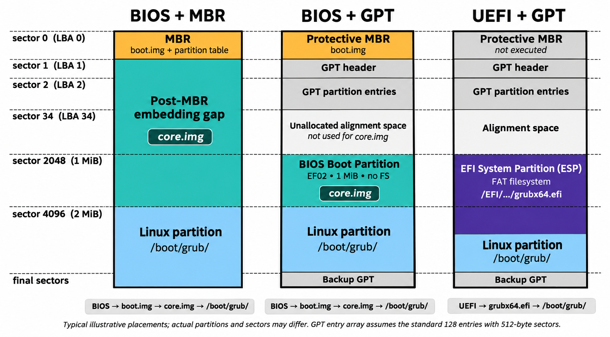
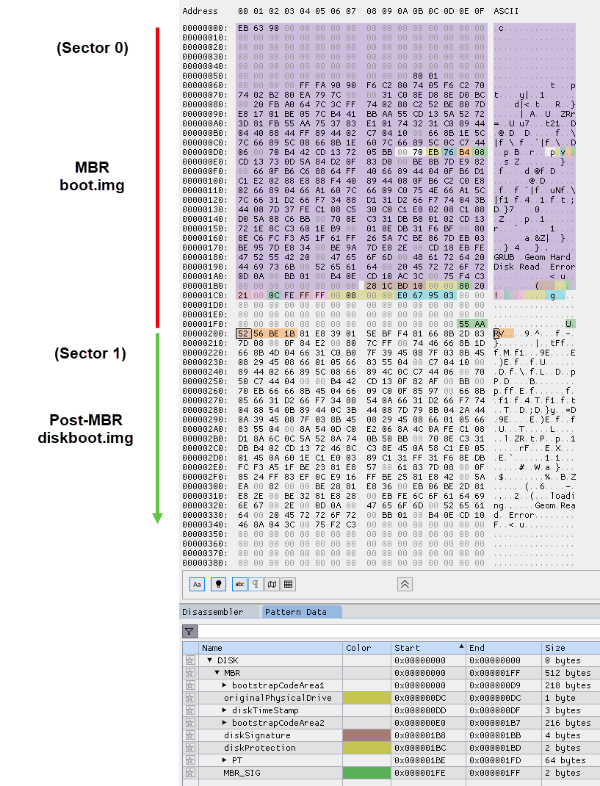

# Bootloader: GRUB

The [previous chapter](05_bootloader_syslinux.md) examined Syslinux — a simple scan-and-chainload MBR bootloader. **GRUB** (Grand Unified Bootloader) takes a fundamentally different approach: it uses a multi-stage architecture with filesystem drivers, giving it the ability to read filesystems before the OS is even running. This makes GRUB the most capable — and the most complex — bootloader in common use.

## What Is GRUB?

GRUB is the most widely used bootloader in the Linux ecosystem. Originally created by Erich Boleyn in 1995, it became an official GNU project in 1999. The current version (**GRUB 2**) is a complete rewrite (development began ~2002 as PUPA, reached stable release in 2012) and the default bootloader on most Linux distributions. For the full family of GRUB variants, see the [bootloader catalog](03_bootloaders.md#linux).

GRUB 2's boot path depends on the firmware. On **BIOS** systems, it uses a three-stage chain: `boot.img` → `core.img` → `/boot/grub/`. On **UEFI** systems, the firmware loads `grubx64.efi` directly from the EFI System Partition, bypassing `boot.img` and `core.img` entirely.

|                    | BIOS + MBR | BIOS + GPT | UEFI + GPT |
|--------------------|------------|------------|------------|
| **Firmware loads** | `boot.img` (440 bytes in the MBR) | `boot.img` (440 bytes in the protective MBR) | `grubx64.efi` from the ESP (or `shimx64.efi` → `grubx64.efi` with Secure Boot) |
| **Core image**     | `core.img` in the post-MBR gap | `core.img` in the BIOS Boot Partition (`EF02`) | Built into `grubx64.efi` |
| **Modules**        | `/boot/grub/i386-pc/` | `/boot/grub/i386-pc/` | `/boot/grub/x86_64-efi/` |
| **Configuration**  | `grub.cfg` | `grub.cfg` | `grub.cfg` |



The following sections examine each boot path in detail.

## BIOS Boot Path

### Boot Chain

On BIOS systems, GRUB uses a **three-stage** architecture that gives it filesystem awareness at boot time:

| Stage     | Component              | Location                        | Role |
|-----------|------------------------|---------------------------------|---|
| Stage 1   | `boot.img` (440 bytes) | MBR (sector 0)                  | Loads the first sector of `core.img` from a hardcoded disk address |
| Stage 1.5 | `core.img`             | Post-MBR gap (between MBR and first partition) | Decompressor + filesystem drivers — can read ext4, XFS, FAT, etc. |
| Stage 2   | GRUB modules           | `/boot/grub/` on the filesystem | Full GRUB environment — menu, scripting, chainloading, kernel loading |

```
 BIOS loads MBR (sector 0)
       │
       ▼
 boot.img loads first sector of core.img from a hardcoded LBA
       │
       ▼
 core.img (decompressor + filesystem drivers) → reads /boot/grub/
       │
       ▼
 GRUB modules read grub.cfg → display menu → load kernel + initramfs
```

### Stage 1 — boot.img

GRUB's Stage 1 occupies the first **440 bytes** of the MBR — unlike Rufus and Syslinux, which use the full 446-byte boot code area, GRUB preserves the 6-byte disk signature and disk protection fields. It does **not** scan the partition table — instead, `grub-install` patches a hardcoded disk address into the boot code at install time. At boot, Stage 1 reads that single sector and jumps to it.

This is a fundamentally different design from both the [Rufus MBR](04_bootloader_rufus.md) and [Syslinux](05_bootloader_syslinux.md), which scan the partition table to find the active partition. A full source code walkthrough of `boot.img` follows in the [hands-on section](#source-code-walkthrough--bootimg) below.

### Stage 1.5 — core.img

`core.img` is GRUB's real brain. It lives in the **post-MBR gap** — the unused sectors between the MBR (sector 0) and the first partition (typically starting at sector 2048 on modern disks). This gives `core.img` up to ~1 MB of space — far more than the 440 bytes available to Stage 1.

`core.img` is made up of two parts:

1. **`diskboot.img`** (first sector, uncompressed) — a small loader that reads the rest of `core.img` from disk. It contains a block list of LBA addresses patched in by `grub-install`.

2. **Compressed core** (remaining sectors, LZMA or XZ) — the decompressor, essential filesystem drivers (ext4, XFS, FAT, etc.), and the GRUB core logic that locates and reads `/boot/grub/` from the filesystem.

On MBR-partitioned disks, sectors 1 through ~2047 (the **post-MBR gap**) are typically unused. GRUB stores `core.img` directly in this space (see the **BIOS + MBR** column in the diagram above).

### Stage 2 — Modules and Configuration

Once `core.img` can read the filesystem, it loads GRUB modules from `/boot/grub/` and parses `grub.cfg` — the configuration file that defines the boot menu and tells GRUB which kernel to load. The [Configuration](#configuration--grubcfg) section below covers `grub.cfg` in detail.

GRUB also provides an interactive command-line shell, accessible by pressing **`c`** at the boot menu — see [Exploring the GRUB Shell](#exploring-the-grub-shell) for commands and usage.

### GPT Case: BIOS Boot Partition

The stages above assume an MBR-partitioned disk, where `core.img` fits in the post-MBR gap. On a **GPT-partitioned** disk with BIOS firmware, GPT's partition entry array occupies that gap — there is no room for `core.img`. Instead, GRUB requires a dedicated **BIOS Boot Partition** (type `EF02`, typically 1 MiB, no filesystem) where `grub-install` writes `core.img` directly.

`boot.img` sits in the protective MBR (sector 0). `core.img` is stored in the BIOS Boot Partition (1 MiB). The boot chain is the same — `boot.img` → `core.img` → `/boot/grub/` — but with `core.img` in a dedicated partition instead of the post-MBR gap (see the **BIOS + GPT** column in the diagram above).

## UEFI Boot Path

On UEFI systems, the firmware can read FAT filesystems directly, so it loads GRUB as a standard EFI executable — `boot.img` and `core.img` are not needed:

```
 UEFI firmware reads NVRAM boot entry
       │
       ▼
 Loads grubx64.efi from the EFI System Partition (FAT32)
       │
       ▼
 GRUB reads grub.cfg → displays menu → loads kernel + initramfs
```

| Component | Location | Role |
|---|---|---|
| `grubx64.efi` | EFI System Partition (`/EFI/<distro>/`) | GRUB core + embedded filesystem drivers — replaces both `boot.img` and `core.img` |
| GRUB modules | `/boot/grub/x86_64-efi/` | Additional modules loaded on demand |
| `grub.cfg` | `/boot/grub/` | Boot menu configuration (same format as BIOS) |

UEFI systems use **GPT** partitioning. The **EFI System Partition** (FAT32, typically ~100 MiB) stores `grubx64.efi`, and the UEFI firmware loads GRUB directly from it (see the **UEFI + GPT** column in the diagram above).

> **Secure Boot:** On systems with Secure Boot enabled, the firmware first loads a signed shim (`shimx64.efi`), which verifies and loads `grubx64.efi`. This chain ensures only trusted code runs during boot.

> **Installing GRUB for UEFI:** `grub-install --target=x86_64-efi --efi-directory=/boot/efi` installs `grubx64.efi` to the ESP and creates an NVRAM boot entry. Compare this with the BIOS command: `grub-install --target=i386-pc /dev/sda`.

## Configuration — grub.cfg

`grub.cfg` is the configuration file that GRUB reads at boot time. It lives at `/boot/grub/grub.cfg`, controls the boot menu, kernel selection, and boot parameters, and is [auto-generated](#how-grubcfg-is-generated) — not meant to be edited by hand.

Unlike LILO — which required reinstallation (running the `lilo` command) after every kernel or configuration change — GRUB reads `grub.cfg` from the filesystem each time it boots. Installing a new kernel and regenerating `grub.cfg` is all it takes.

### What grub.cfg Contains

`grub.cfg` is a shell-like script. Each boot option is defined in a `menuentry` block:

```bash
menuentry 'Ubuntu' --class ubuntu --class os {
    load_video
    insmod gzio
    insmod part_msdos
    insmod ext2
    set root='hd0,msdos1'
    linux  /boot/vmlinuz-6.8.0-45-generic root=/dev/sda1 ro quiet splash
    initrd /boot/initrd.img-6.8.0-45-generic
}
```

| Line                          | Purpose                   |
|-------------------------------|---------------------------|
| `menuentry 'Ubuntu'`          | Defines a named boot option that appears in the GRUB menu |
| `insmod ext2`                 | Loads the ext2/ext3/ext4 filesystem module so GRUB can read the partition |
| `set root='hd0,msdos1'`       | Tells GRUB which partition contains the kernel (`hd0` = first disk, `msdos1` = first MBR partition) |
| `linux /boot/vmlinuz-...`     | Loads the kernel image and passes boot parameters (`root=` tells the **kernel** which partition to mount as `/`, `ro` mounts it read-only initially, `quiet splash` suppresses verbose boot messages) |
| `initrd /boot/initrd.img-...` | Loads the initial RAM filesystem alongside the kernel |

GRUB uses its built-in filesystem drivers — loaded in the earlier stages — to read both the kernel and the initramfs directly from disk.

### How grub.cfg Is Generated

`grub.cfg` is **auto-generated** — it is not meant to be edited by hand. Two sources control its contents:

| Source                 | Purpose |
|------------------------|---------|
| `/etc/default/grub`    | User-facing settings — timeout, default entry, kernel parameters |
| `/etc/grub.d/` scripts | Template scripts that produce the actual `menuentry` blocks |

The scripts in `/etc/grub.d/` run in numerical order:

| Script         | Role |
|----------------|------|
| `00_header`    | Global defaults — timeout, terminal settings, graphical mode |
| `10_linux`     | Auto-detects installed Linux kernels and generates an entry for each |
| `30_os-prober` | Detects other operating systems (Windows, other Linux distros) and adds entries |
| `40_custom`    | User-defined entries — anything added here is included verbatim |

Running `update-grub` (Debian/Ubuntu) or `grub-mkconfig -o /boot/grub/grub.cfg` (other distros) reads `/etc/default/grub`, executes each script in `/etc/grub.d/` in order, and writes the combined output to `/boot/grub/grub.cfg`.

### Common Settings in /etc/default/grub

```bash
GRUB_DEFAULT=0                             # boot the first menu entry by default
GRUB_TIMEOUT=5                             # show the menu for 5 seconds
GRUB_CMDLINE_LINUX_DEFAULT="quiet splash"  # kernel parameters for normal entries
GRUB_CMDLINE_LINUX=""                      # kernel parameters for ALL entries (including recovery)
GRUB_DISABLE_OS_PROBER=false               # enable detection of other operating systems
```

After changing any of these settings, run `sudo update-grub` to regenerate `grub.cfg`. The changes take effect on the next boot — no reinstallation of the bootloader is needed.

## Comparison — All Three Bootloaders

The three MBR bootloaders examined across this series represent very different design philosophies:

| Feature                  | Rufus MS-DOS ([Ch. 4](04_bootloader_rufus.md))         | Syslinux ([Ch. 5](05_bootloader_syslinux.md)) | GRUB |
|--------------------------|--------------------------------------------------------|-----------------------------------------------|---|
| **MBR complexity**       | High — user prompt, timeout, dual-disk read, disk swap | High — extended partition traversal, EBIOS detection, error messages | Minimal — load one sector from hardcoded LBA |
| **Number of stages**     | MBR → VBR                                              | MBR → VBR → `ldlinux.sys` | `boot.img` → `core.img` → modules |
| **Finds next stage via** | Partition table scan                                   | Partition table scan → FAT filesystem | Hardcoded sector address |
| **Filesystem awareness** | None (raw sector reads only)                           | Stage 2 reads FAT | Stage 1.5 reads ext4, XFS, FAT, etc. |
| **Configuration file**   | None | `syslinux.cfg`                                  | `grub.cfg` (auto-generated) |
| **User menu**            | MBR-level prompt (before VBR)                          | Stage 2 text/graphical menu | Stage 2 graphical menu |

> **Common ground:** All three bootloaders use **BIOS INT 13h** for disk I/O, exactly as described in the [Rufus chapter](04_bootloader_rufus.md). The differences are in what they do with that access — Rufus implements custom logic in the MBR itself, while Syslinux and GRUB defer most work to later stages.

## Hands-On — Ubuntu

[Ubuntu](https://ubuntu.com/) is one of the most popular Linux distributions. It uses GRUB 2 as its default bootloader.

### Creating the Bootable USB

1. Download the **Ubuntu Server 26.04.1 LTS** ISO from [ubuntu.com/download/server](https://ubuntu.com/download/server).
2. Launch [Rufus](https://rufus.ie/) and select the Ubuntu ISO.
3. Write the image to a USB drive (MBR partition scheme, BIOS target).

Once the bootable USB is created, open it in [ImHex](https://imhex.werwolv.net/) to inspect the MBR — the same approach used in the [Rufus](04_bootloader_rufus.md) and [Syslinux](05_bootloader_syslinux.md) chapters.



The screenshot shows the first two GRUB stages on the USB drive in ImHex:

**Stage 1 — `boot.img`** (offsets `0x000`–`0x1FF`, sector 0):

The **Pattern Data** panel (bottom) breaks out the MBR fields:

- **`bootstrapCodeArea1`** + **`bootstrapCodeArea2`** (440 bytes total) — this is `boot.img`. The GRUB error strings are visible in the ASCII column around offset `0x180`: `GRUB  Geom  Hard  Disk  Read  Error`.
- **`diskSignature`** (4 bytes at `0x1B8`) and **`diskProtection`** (2 bytes at `0x1BC`) — the 6-byte gap that `boot.img` preserves.
- **`PT`** (64 bytes at `0x1BE`) — the partition table, highlighted in colour. One active FAT32 partition starting at LBA 2048.
- **`MBR_SIG`** (`0x55` at `0x1FE`, `0xAA` at `0x1FF`) — the valid boot sector signature. The BIOS checks for these two bytes before executing the MBR code; without them, the BIOS skips the disk.

**Stage 1.5 — `diskboot.img`** (offsets `0x200`+, sector 1):

Immediately after the MBR, the hex dump continues into the **post-MBR gap** — the first sector here is `diskboot.img`, the uncompressed header of `core.img`. Its own error/status strings are visible in the ASCII column around offset `0x310`: `loading`, `Geom`, `Read`, `Error`. This is the code that `boot.img` loads via the hardcoded LBA — it then reads the remaining compressed `core.img` sectors (printing `loading...` as it goes) and hands off to the GRUB core.

### Source Code Walkthrough — boot.img

**Source code:** [grub-core/boot/i386/pc/boot.S](https://github.com/rhboot/grub2/blob/6cac608cbe05b95ec2903897ad19dbd0499ab60d/grub-core/boot/i386/pc/boot.S)

> **Syntax note:** The code below is shown in Intel-style syntax with `#` comments for readability. The original GRUB source uses AT&T/GAS syntax (operands reversed, `%` register prefix).

Unlike Rufus and Syslinux — which scan partition tables, prompt users, or traverse extended partitions — GRUB's `boot.img` has a single job: **load one sector from a hardcoded disk address and jump to it**. This makes it the simplest MBR bootloader in the series.

#### Step 1 — Setup

```asm
_start:
    jmp  after_BPB         # skip the BIOS Parameter Block area
    nop

    # --- BPB area (bytes 4–89) — reserved for filesystem compatibility ---

    .org 0x5C              # patched fields start here
kernel_address:
    .word 0x8000           # where to load diskboot.img in memory

kernel_sector:
    .long 1                # LBA of diskboot.img ← PATCHED by grub-install
kernel_sector_high:
    .long 0                # upper 32 bits (for LBA48)

boot_drive:
    .byte 0xFF             # 0xFF = use whatever drive BIOS passed in DL
```

The `kernel_sector` field is the key to GRUB's design. At install time, `grub-install` writes the **exact LBA of `diskboot.img`** (the first sector of `core.img`) into this field. No scanning, no filesystem traversal — just a hardcoded number.

#### Step 2 — Segment and Stack Initialization

```asm
after_BPB:
    cli                    # disable interrupts during setup
    ljmp 0:real_start      # normalize CS:IP (some BIOSes jump to 07C0:0000)

real_start:
    xor  ax, ax
    mov  ds, ax            # DS = 0
    mov  ss, ax            # SS = 0
    mov  sp, 0x2000        # stack at GRUB_BOOT_MACHINE_STACK_SEG

    sti                    # re-enable interrupts

    # Check if grub-install forced a specific boot drive
    mov  al, [boot_drive]
    cmp  al, 0xFF
    je   1f
    mov  dl, al            # override BIOS drive number
1:
    push dx                # save drive number

    # Print "GRUB " to the screen
    mov  si, notification_string
    call message
```

> **No relocation:** Unlike Rufus and Syslinux, GRUB's `boot.img` does **not** relocate itself to `0x0600`. It stays at `0x7C00` and loads `diskboot.img` into a separate buffer address (`0x7000:0x0000`), then copies it to `kernel_address` (`0x8000`). There is no need to free `0x7C00` because `diskboot.img` is not a VBR — it is GRUB's own code at a different address.

#### Step 3 — LBA Detection and Disk Read

```asm
    # Check if BIOS supports LBA (INT 13h extensions)
    mov  ah, 0x41
    mov  bx, 0x55AA
    int  0x13
    pop  dx                # restore drive number (INT 13h may clobber DL)
    push dx

    jc   chs_mode          # carry set → no LBA support
    cmp  bx, 0xAA55
    jne  chs_mode
    and  cx, 1
    jz   chs_mode

lba_mode:
    # Build Disk Address Packet (DAP) on the stack
    xor  ax, ax
    mov  [si+4], ax        # buffer offset = 0
    inc  ax
    mov  [si-1], al        # mode = non-zero (LBA)
    mov  [si+2], ax        # sector count = 1
    mov  word [si], 0x0010 # DAP size = 16 bytes
    mov  ebx, [kernel_sector]
    mov  [si+8], ebx       # LBA from the patched field
    mov  ebx, [kernel_sector_high]
    mov  [si+12], ebx      # upper 32 bits
    mov  word [si+6], 0x7000  # buffer segment

    mov  ah, 0x42          # INT 13h function 42h: extended read
    int  0x13
    jc   chs_mode          # fall back to CHS on error

    mov  bx, 0x7000
    jmp  copy_buffer
```

The LBA path builds a DAP and reads `kernel_sector` — the hardcoded address that `grub-install` patched in. If LBA fails, the CHS fallback converts the LBA to cylinder/head/sector and uses INT 13h AH=02h (omitted for brevity — same pattern as Rufus and Syslinux).

#### Step 4 — Copy and Jump

```asm
copy_buffer:
    pusha
    push ds

    mov  cx, 256           # 256 words = 512 bytes
    mov  ds, bx            # DS = buffer segment (0x7000)
    xor  si, si            # source offset = 0
    mov  di, [kernel_address]  # destination = 0x8000
    mov  es, si            # ES = 0

    cld
    rep  movsw             # copy: 0x7000:0 → 0:0x8000

    pop  ds
    popa

    jmp  [kernel_address]  # jump to diskboot.img at 0x8000!
```

This is the entire punchline of `boot.img`: copy the loaded sector to `kernel_address` and jump. The code at `0x8000` is `diskboot.img` — the first sector of `core.img` — which contains a block list of LBA addresses for the remaining `core.img` sectors and loads them all.

#### Error Handling

Like Syslinux, GRUB uses compact error strings to save space:

```asm
notification_string:     .asciz "GRUB "
geometry_error_string:   .asciz "Geom"
hd_probe_error_string:   .asciz "Hard Disk"
read_error_string:       .asciz "Read"
general_error_string:    .asciz " Error\r\n"
```

Errors are printed as a prefix + "` Error`" — for example, `"Read"` + `" Error\r\n"` produces `"Read Error"`. After printing, `boot.img` calls `INT 18h` (boot failure) and halts.

### Exploring the GRUB Shell

Press **`c`** at the GRUB boot menu to enter the interactive shell — a minimal BASH-like environment for inspecting disks, loading kernels manually, and recovering from a missing or broken `grub.cfg`:

```
                    GNU GRUB  version 2.04

 Minimal BASH-like line editing is supported. For the first word,
 TAB lists possible command completions. Anywhere else TAB lists
 possible device or file completions. ESC at any time exits.

 grub> _
```

**Useful commands:**

| Command | Description |
|---|---|
| `ls` | List all disks and partitions: `(hd0) (hd0,msdos1) (hd0,gpt2)` |
| `ls (hd0,1)/` | List files on a partition |
| `set` | Show all environment variables (`root`, `prefix`, `default`, etc.) |
| `cat (hd0,1)/etc/os-release` | Display a file's contents |
| `linux /vmlinuz root=/dev/sda1` | Load a kernel with parameters |
| `initrd /initrd.img` | Load an initial ramdisk |
| `boot` | Boot the loaded kernel + initrd |
| `configfile /boot/grub/grub.cfg` | Load a config file manually |

**Example — manually booting Ubuntu:**

```
grub> set root=(hd0,1)
grub> linux /boot/vmlinuz root=/dev/sda1
grub> initrd /boot/initrd.img
grub> boot
```

This is invaluable when `grub.cfg` is missing or corrupted — you can boot the system manually and fix the configuration from a running OS.

---

[← Previous: Bootloader: Syslinux](05_bootloader_syslinux.md) | [Next: Dual Boot →](07_dualboot.md)
