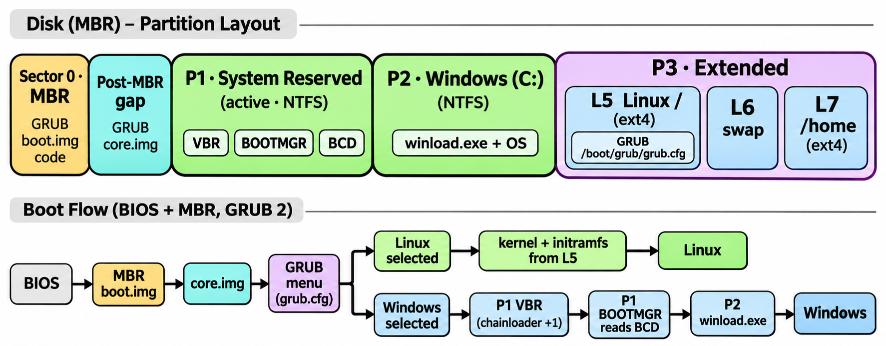
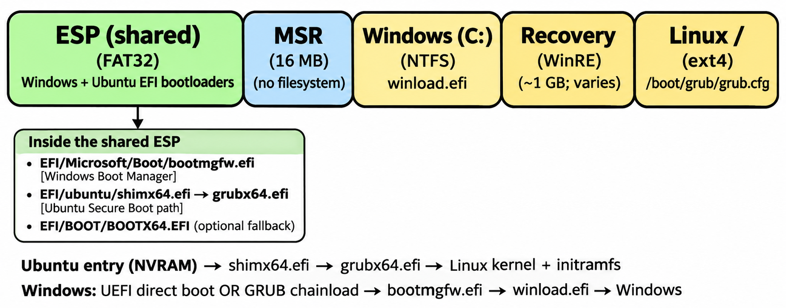

# Dual Boot

The [previous chapter](06_bootloader_grub.md) examined GRUB — a multi-stage bootloader with filesystem drivers and a full scripting environment. One of GRUB's most important capabilities is **chainloading**: the ability to hand off boot control to another bootloader. This is what makes dual boot possible — running two operating systems on the same machine, with a boot menu to choose between them.

## What Is Dual Boot?

Dual boot is a setup where two operating systems share the same computer, each on its own partition. A bootloader menu lets the user choose which OS to start — only one runs at a time.

This differs from **virtualization** (where one OS runs inside another with a performance overhead) and from **live USB booting** (where the OS runs from removable media without installation). Dual boot gives each OS full, native access to the hardware.

The most common combination is **Windows + Linux**. Typical reasons include:

- Running Linux for development while keeping Windows for specific applications or games
- Learning Linux without giving up a working Windows installation
- Testing different distributions alongside a stable primary OS

## Chainloading

Each operating system ships its own bootloader, but in a dual-boot setup only one can be the **primary** — the one the firmware loads first. On BIOS systems, only one bootloader can occupy the MBR. On UEFI systems, multiple bootloaders coexist on the ESP, but only one runs first. The primary bootloader needs a way to start the other OS's bootloader when the user selects it.

This mechanism is called **chainloading**: one bootloader loads another into memory and transfers control to it. The name comes from the idea of chaining bootloaders together — firmware → GRUB → Windows Boot Manager. Each link in the chain loads the next and jumps to it. The target bootloader runs as if the firmware had loaded it directly; it never knows another bootloader was involved.

How chainloading works depends on the firmware:

### BIOS — Loading a Boot Sector

On BIOS systems, GRUB's `chainloader +1` command loads the first sector (the VBR) of the target partition into memory at `0x7C00` and jumps to it — exactly what the original MBR boot code would have done:

```bash
menuentry 'Windows 10' {
    insmod chain
    insmod ntfs
    set root='hd0,msdos1'
    chainloader +1
}
```

The `+1` means "load one sector from the start of the partition" — this is the partition's VBR (Volume Boot Record). GRUB loads it and jumps — the Windows VBR then loads `BOOTMGR` as if the BIOS had booted it directly.

### UEFI — Loading an EFI Binary

On UEFI systems, chainloading loads a `.efi` executable rather than a raw sector:

```bash
menuentry 'Windows Boot Manager' {
    insmod chain
    insmod fat
    search --no-floppy --fs-uuid --set=root <ESP-UUID>
    chainloader /EFI/Microsoft/Boot/bootmgfw.efi
}
```

GRUB uses its FAT filesystem driver to read `bootmgfw.efi` from the ESP and transfers control to it.

### Automatic Detection — os-prober

In practice, you rarely write chainload entries by hand. When you run `update-grub` (or `grub-mkconfig`), the script `30_os-prober` from [`/etc/grub.d/`](06_bootloader_grub.md#how-grubcfg-is-generated) scans all partitions for other installed operating systems:

1. **Windows** — `os-prober` checks NTFS and FAT partitions for `bootmgr` (BIOS) or `bootmgfw.efi` (UEFI).
2. **Other Linux distributions** — it looks for `/etc/os-release` and kernel files.
3. **Result** — each detected OS gets a `menuentry` block with the appropriate `chainloader` command added to `grub.cfg`.

This is why installing Linux after Windows "just works" — the installer runs `update-grub`, `os-prober` finds Windows, and GRUB's menu includes a Windows entry automatically.

> **Note:** Some distributions (notably Ubuntu 22.04+) disable `os-prober` by default for security reasons — mounting every partition to scan for OSes carries risk. To enable it, set `GRUB_DISABLE_OS_PROBER=false` in `/etc/default/grub` and run `sudo update-grub`. See the [grub.cfg configuration](06_bootloader_grub.md#configuration--grubcfg) in the GRUB chapter.

## Boot Flow

With chainloading explained, the remaining question is: how do two operating systems share a single disk, and how does GRUB become the primary bootloader? The answer depends on the firmware and partition scheme.

### BIOS + MBR

On BIOS systems, the Linux installer writes GRUB's `boot.img` into the MBR, **replacing** the Windows MBR boot code. From that point on, GRUB is the first code that runs at boot:

```
 BIOS loads MBR (sector 0)
       │
       ▼
 GRUB boot.img → core.img → grub.cfg → boot menu
       │
       ├── Linux selected → GRUB loads kernel + initramfs directly
       │
       └── Windows selected → GRUB chainloads the Windows VBR
                                     │
                                     ▼
                               VBR → BOOTMGR → Windows kernel
```

When the user selects Windows, GRUB [chainloads](#bios--loading-a-boot-sector) the VBR of the System Reserved partition. The VBR loads `BOOTMGR`, which reads the BCD store and loads the Windows kernel. From Windows' perspective, the boot path is identical to a single-OS system.

The partition layout typically uses two primary entries for Windows and an extended partition for Linux:



| Entry | Type             | Purpose |
|-------|------------------|---------|
| 1     | Primary (active) | System Reserved — Windows boot files (`BOOTMGR`, BCD) |
| 2     | Primary          | C: — Windows |
| 3     | Extended         | Container for Linux partitions |
| 5     | Logical          | `/` — Linux root (ext4) |
| 6     | Logical          | swap |

GRUB's `core.img` lives in the post-MBR gap (sectors 1–2047), between the MBR and the first partition. Linux itself lives in logical partitions inside the extended partition — not because Linux requires logical partitions, but because Windows has already taken the primary slots.

> **Full layout details:** [Two–Three Primaries + One Extended (Dual Boot)](https://github.com/ManiAm/storage-and-file-systems/blob/master/docs/07_partition_layout.md#twothree-primaries--one-extended-dual-boot) in the Disk Storage project.

### UEFI + GPT

On UEFI systems, both bootloaders coexist on the **EFI System Partition** (ESP) — each in its own folder. Unlike BIOS, where GRUB replaces the Windows boot code, UEFI allows side-by-side installation:

```
 UEFI firmware reads NVRAM boot order
       │
       ▼
 Loads shimx64.efi → grubx64.efi from ESP (/EFI/ubuntu/)
       │
       ▼
 GRUB reads grub.cfg → boot menu
       │
       ├── Linux selected → GRUB loads kernel + initramfs directly
       │
       └── Windows selected → GRUB chainloads bootmgfw.efi from ESP
                                     │
                                     ▼
                               Windows Boot Manager → Windows kernel
```

The ESP contains separate folders — installing Linux does not touch the Windows files:

```
ESP (FAT32)
├── EFI/
│   ├── Microsoft/
│   │   └── Boot/
│   │       └── bootmgfw.efi       ← Windows Boot Manager
│   ├── ubuntu/
│   │   ├── shimx64.efi            ← Secure Boot shim (signed by Microsoft)
│   │   └── grubx64.efi            ← GRUB
│   └── BOOT/
│       └── BOOTX64.EFI            ← fallback bootloader
```

The UEFI firmware's built-in boot manager uses an ordered list of boot entries stored in NVRAM. The Linux installer adds its own entry and sets it as the first in the boot order:

```
$ efibootmgr -v
BootCurrent: 0001
BootOrder: 0001,0000
Boot0000* Windows Boot Manager  HD(1,GPT,...)/File(\EFI\Microsoft\Boot\bootmgfw.efi)
Boot0001* ubuntu                HD(1,GPT,...)/File(\EFI\ubuntu\shimx64.efi)
```

Because UEFI's boot manager understands individual boot entries (not just devices), you can bypass GRUB entirely by pressing the firmware boot menu key (usually **F12** or **F2**) and selecting "Windows Boot Manager" directly — no chainloading needed.

The partition layout shares the ESP between both OSes:



| # | Partition    | Filesystem | Purpose |
|---|--------------|------------|---------|
| 1 | ESP (shared) | FAT32      | `\EFI\Microsoft\...` and `\EFI\ubuntu\...` |
| 2 | MSR          | None       | Windows reserved (16 MB) |
| 3 | C: (shrunk)  | NTFS       | Windows |
| 4 | Recovery     | NTFS       | Windows Recovery Environment |
| 5 | Linux root   | ext4       | `/` |

The Linux installer shrinks the Windows partition to make room for Linux. Both OSes mount the same ESP — Windows at a hidden drive letter, Linux typically at `/boot/efi`.

> **Full layout details:** [Dual Boot — Windows + Linux (UEFI + GPT)](https://github.com/ManiAm/storage-and-file-systems/blob/master/docs/07_partition_layout.md#dual-boot--windows--linux-uefi--gpt) in the Disk Storage project.

## Installation Order — Windows First, Then Linux

The recommended order for setting up a dual-boot system is:

**1. Install Windows first.** Windows assumes it is the only OS on the disk. On BIOS, it writes its own MBR boot code. On UEFI, it creates the ESP and adds its NVRAM boot entry. In both cases, it makes no effort to detect or preserve other operating systems.

**2. Install Linux second.** The Linux installer detects Windows and configures GRUB to work alongside it:

| | BIOS + MBR | UEFI + GPT |
|---|---|---|
| **What the installer does** | `grub-install` writes `boot.img` into the MBR, replacing the Windows boot code | `grub-install` places `grubx64.efi` on the existing ESP (alongside `bootmgfw.efi`) and creates an NVRAM entry |
| **How Windows is detected** | `update-grub` runs `os-prober`, which finds `BOOTMGR` and adds a chainload entry | `update-grub` runs `os-prober`, which finds `bootmgfw.efi` and adds a chainload entry |
| **Result** | GRUB menu with both Linux and Windows | GRUB menu with both Linux and Windows |

### What If You Install Windows Second?

Installing Windows after Linux causes problems because Windows overwrites the boot configuration without checking for other OSes:

**BIOS + MBR:** Windows replaces the MBR boot code with its own. GRUB is gone — the system boots straight into Windows. GRUB's `core.img` is still in the post-MBR gap, but nothing points to it.

→ **Fix:** Boot from a Linux live USB, mount the Linux partition, and run:
```bash
sudo grub-install /dev/sda
sudo update-grub
```

**UEFI + GPT:** Windows adds its NVRAM entry and sets itself as the first boot option. GRUB's files on the ESP are usually preserved (Windows does not delete other `\EFI\` folders), but GRUB no longer runs first.

→ **Fix:** Change the boot order back to GRUB using `efibootmgr` or the UEFI firmware setup menu:
```bash
sudo efibootmgr --bootorder 0001,0000
```

## Common Issues

| Issue | Cause | Solution |
|---|---|---|
| **Windows update removes GRUB** | Major Windows updates may overwrite the MBR (BIOS) or reset the NVRAM boot order (UEFI) | Boot from a live USB and reinstall GRUB, or fix the boot order with `efibootmgr` |
| **Windows not in GRUB menu** | `os-prober` disabled by default on some distros | Set `GRUB_DISABLE_OS_PROBER=false` in `/etc/default/grub`, then `sudo update-grub` |
| **Clock is wrong after switching OSes** | Windows stores **local time** in the hardware clock; Linux stores **UTC** | Either tell Linux to use local time: `timedatectl set-local-rtc 1`, or set Windows to use UTC via registry |
| **Cannot mount Windows partition from Linux** | Windows Fast Startup (hybrid shutdown) locks the NTFS volume | Disable Fast Startup in Windows: Power Options → "Choose what the power buttons do" → uncheck "Turn on fast startup" |
| **Secure Boot blocks GRUB** | Unsigned GRUB binary rejected by UEFI firmware | Use the distro's signed shim (`shimx64.efi` → `grubx64.efi`), or disable Secure Boot in firmware settings |

## Multiboot USB — Ventoy

Traditional dual boot installs two operating systems side by side on a hard drive. A different approach is to boot multiple OS images from a single USB drive — useful for testing, installation, or rescue.

[Ventoy](https://www.ventoy.net/) is an open-source tool that creates a multiboot USB. You install Ventoy to the USB drive once, then simply copy ISO files onto it — no need to re-flash for each image:

1. Ventoy partitions the USB into a small EFI partition (for UEFI boot) and a large exFAT data partition.
2. Copy any number of ISO files to the data partition — Ubuntu, Fedora, Windows installer, rescue tools, etc.
3. At boot, Ventoy's bootloader scans the USB, lists all ISOs in a menu, and boots the selected one directly.

Ventoy supports both BIOS and UEFI (including Secure Boot) and works with Linux, Windows, and many other bootable ISO images. [YUMI](https://pendrivelinux.com/) and [PenDriveLinux](https://pendrivelinux.com/) offer similar multiboot USB functionality.

---

[← Previous: Bootloader: GRUB](06_bootloader_grub.md) | [Next: Boot Over Network →](08_boot_over_network.md)
