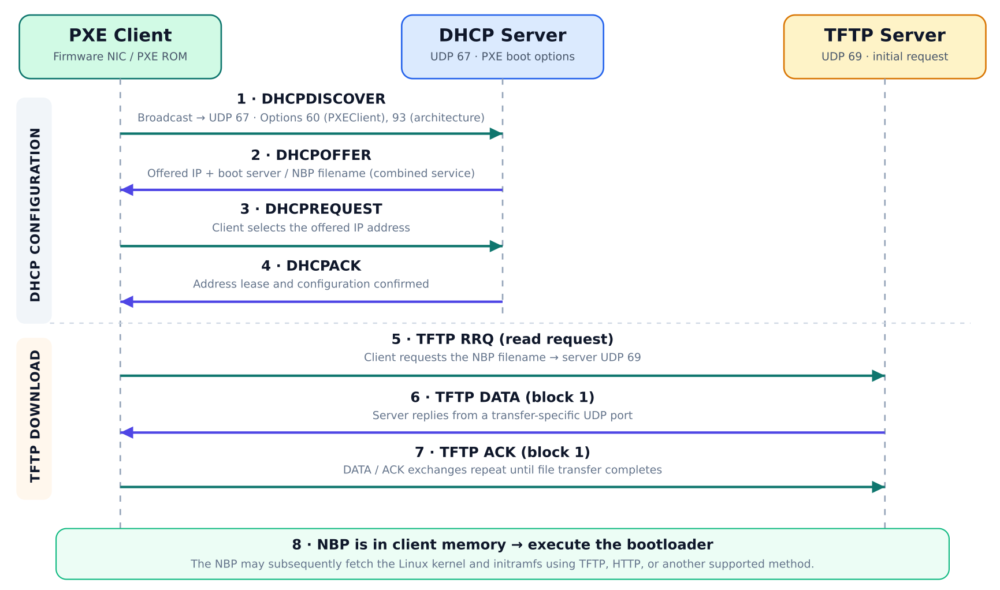
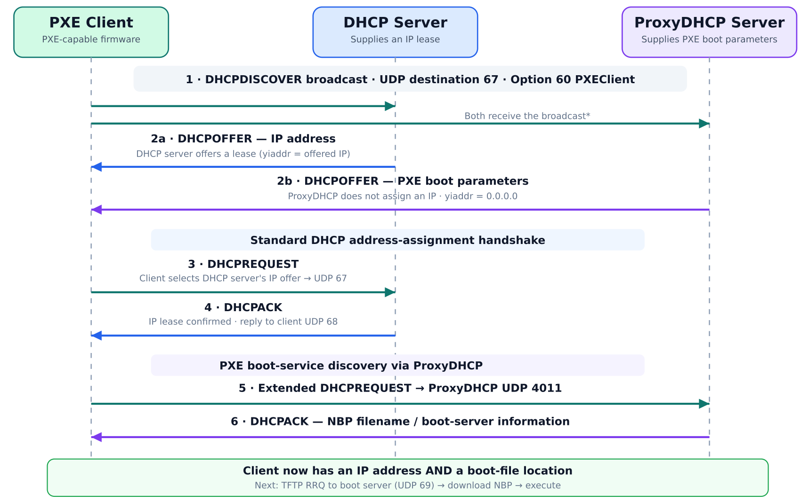
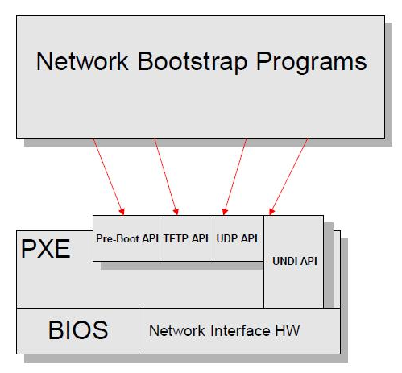
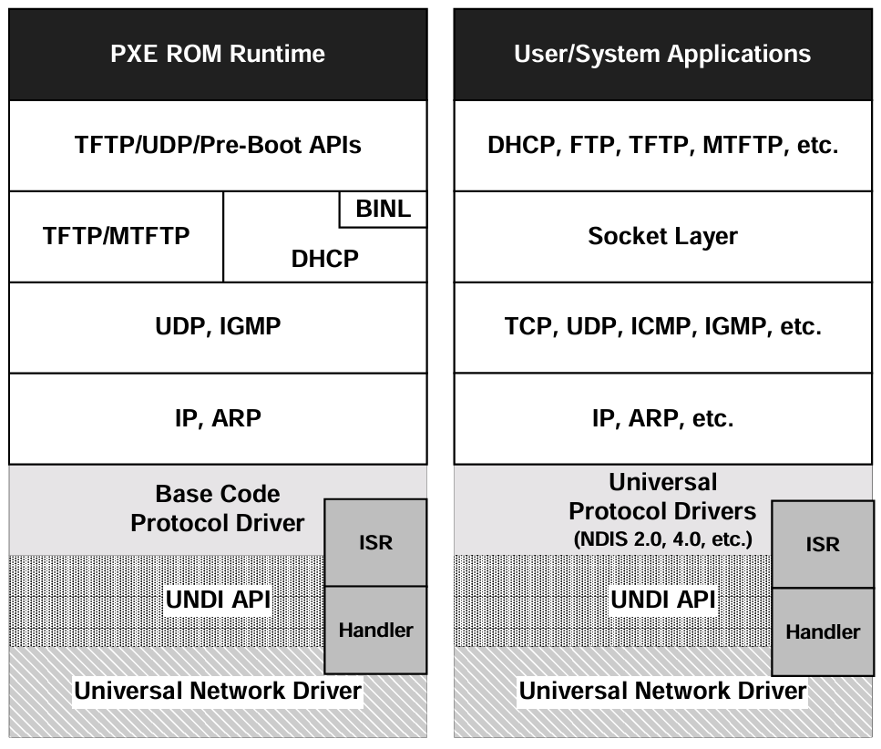

# Boot Over Network

In all the scenarios covered so far, the OS was loaded from a local disk. But what if a computer has no local storage, or you need to deploy an OS to 
hundreds of machines at once? That is where network booting comes in.

Network booting allows a computer to load its operating system (or an installer) from a remote server instead of a local disk. This is essential in environments that require centralized OS deployment or automated provisioning — such as data centers, diskless workstations, and large-scale provisioning systems.

Common use cases include:

- **Diskless booting** — boot into a network-mounted OS where no local hard disk is needed
- **OS installation** — deploy an OS to a computer's local drive over the network, without physical media (CD, DVD, USB)
- **Diagnostics** — temporarily boot a diagnostic environment, downloading tools from a remote server into local memory
- **Data recovery** — boot a recovery OS from the network to rescue data from a failing local drive

## PXE (Preboot Execution Environment)

**PXE** (pronounced "pixie") is an industry-standard protocol defined by Intel that enables a computer to boot from the network. It works with both BIOS and UEFI firmware.

PXE follows a **client-server architecture**:

- **PXE client** — the computer that needs to boot. Its NIC (network interface card) firmware contains a small PXE implementation that can request an IP address and download an **NBP (Network Bootstrap Program)** from the network. The client has no operating system yet — the PXE firmware handles the entire network conversation until the NBP is downloaded and executed.

- **PXE server** — one or more servers on the network that provide the boot infrastructure: a **DHCP server** assigns an IP address and tells the client where to find the NBP, and a **TFTP (Trivial File Transfer Protocol) server** hosts it for download.

> PXE itself downloads only the NBP. The NBP is typically a bootloader such as PXELINUX, GRUB, or iPXE. The NBP then takes over and fetches the OS kernel and initramfs from the network.

### What Happens After PXE Boot?

Everything downloaded during a PXE boot goes into **RAM**, not onto a local disk. What happens next depends on the use case:

- **Diskless boot** — the OS runs entirely from memory (or mounts a root filesystem over the network via NFS (Network File System)). Nothing is written to local storage. If the machine reboots, **everything is gone** — the PXE process starts from scratch. This is by design: diskless workstations boot fresh from the network every time.

- **OS installation** — the NBP downloads an installer kernel and initramfs (such as a Kickstart or Preseed environment) into memory. The installer then writes the OS to the local disk — just like installing from a USB drive. After installation, the boot order is changed so the machine boots from disk on subsequent startups. The OS is now local and survives reboots; PXE is no longer needed.

- **Diagnostics / recovery** — a lightweight diagnostic environment is loaded into memory, used temporarily, and discarded on reboot.

In all three cases, PXE itself only loads files into memory — whether anything is written to disk depends entirely on what the downloaded software does next.

### History

PXE was introduced as part of Intel's **Wired for Management (WfM)** framework — a specification for managing networked PCs. PXE was later separated into its own specification, published by Intel and SystemSoft:

| Version | Date           | Notes |
|---------|----------------|-------|
| PXE 1.0 | 1997           | Part of WfM; basic network boot |
| PXE 2.0 | December 1998  | Standalone specification |
| PXE 2.1 | September 1999 | Added Boot Server Discovery, Proxy DHCP, and split ROM support |

PXE v2.1 was fully defined only for the **IA-32** (x86) architecture. IPv6-based PXE was later defined in the **UEFI 2.2** specification (and expanded in UEFI 2.6).

The original PXE client firmware was an **Option ROM** — a small program embedded in the NIC's own ROM chip. A PC was made PXE-capable by installing a NIC that carried a PXE Option ROM. Intel provided the reference client firmware as a linkable IA-32 object code module in their Product Development Kit (PDK). Today, PXE code is included directly in the NIC's firmware and as part of the **UEFI firmware** on modern motherboards.

Since v2.1, PXE adoption has been ubiquitous — it is virtually impossible to find a network card without PXE firmware today. Inexpensive Gigabit Ethernet hardware has made PXE the most practical method for deploying an OS across many machines compared to physical media like CDs, DVDs, and USB drives.

### How PXE Works

When a computer is configured to network boot (by setting PXE as a higher priority than local disk in the BIOS/UEFI boot order), the PXE firmware runs instead of loading from a local disk. The boot process has two phases:

**Phase 1 — Network configuration (DHCP).** The client obtains an IP address and the location of the NBP using DHCP.

**Phase 2 — NBP download (TFTP).** The client downloads the NBP via TFTP and executes it.

The detailed exchange:

1. **DHCPDISCOVER** — the PXE client broadcasts a discover message to UDP port 67, containing [PXE-specific DHCP options](#pxe-specific-dhcp-options) that identify it as a PXE client (including Option 60 `PXEClient` and Option 93 with the client's architecture type).
2. **DHCPOFFER** — the DHCP server responds with an offer carrying the client's IP address, boot server IP, and the NBP file path.
3. **DHCPREQUEST** — the client sends a request to accept the offered IP address.
4. **DHCPACK** — the server confirms the lease; the client now has a valid IP address and knows where to find the NBP.
5. **TFTP RRQ (read request)** — the client sends a TFTP read request to the boot server (UDP port 69), asking for the NBP file by name.
6. **TFTP DATA** — the server begins sending the NBP in numbered blocks from a transfer-specific UDP port.
7. **TFTP ACK** — the client acknowledges each block; DATA/ACK exchanges repeat until the entire file is transferred.
8. **Execute NBP** — the NBP is now in client memory. The client executes it. The NBP uses the PXE APIs to fetch the OS kernel and initramfs and boots the operating system.

> **Wake-on-LAN:** A PXE-enabled computer's NIC can remain active and connected to the LAN even when the computer is powered off. It listens for a **magic packet** — a special frame containing six bytes of `0xFF` followed by the target NIC's MAC address repeated sixteen times. When received, the NIC signals the motherboard to power on, and the computer boots via PXE as normal. Wake-on-LAN (WoL) must be enabled in BIOS/UEFI settings for this to work.

### PXE-Specific DHCP Options

Standard DHCP provides an IP address and basic network configuration. PXE extends DHCP with additional options that let the server identify the client's architecture and provide boot-specific parameters. These options are defined in the PXE 2.1 specification and [RFC 4578](https://www.rfc-editor.org/rfc/rfc4578):

| Option | Name | Purpose |
|--------|------|---------|
| 60 | Vendor Class Identifier | Identifies the client as PXE-capable. Format: `PXEClient:Arch:xxxxx:UNDI:yyyzzz` — encoding the architecture type and UNDI (Universal Network Device Interface) version |
| 93 | Client System Architecture | A 16-bit identifier for the client's pre-boot environment (see table below) |
| 94 | Client Network Interface Identifier | UNDI type and version (e.g., type `1` = UNDI, revision `2.11`) |
| 97 | Client Machine Identifier | A 16-byte GUID/UUID that uniquely identifies the machine |
| 128–135 | PXE vendor-specific | Reserved for PXE boot server discovery and other PXE parameters; all PXE clients must request these in every DHCP packet |

Option 93 is particularly important in mixed environments — it lets the DHCP server serve **different NBPs** depending on the client's architecture:

| Type | Architecture |
|------|--------------|
| 0    | Intel x86PC (BIOS) |
| 6    | EFI IA32 |
| 7    | EFI BC (Byte Code) |
| 9    | EFI x86-64 |

For example, a DHCP server can return `pxelinux.0` for type `0` (BIOS) clients and `grubx64.efi` for type `9` (UEFI x86-64) clients — serving the correct NBP to each automatically.

### Proxy DHCP

In many organizations, the DHCP server is managed by the network team and subject to strict change-control policies — adding PXE-specific options to it may not be permitted. The PXE specification addresses this with **Proxy DHCP** — a way to split the PXE boot requirements across two independently managed servers:

| Server                   | Provides                                                    | Managed by |
|--------------------------|-------------------------------------------------------------|------------|
| **Standard DHCP server** | IP address, subnet mask, gateway — to **all** DHCP clients  | Network team |
| **Proxy DHCP server**    | TFTP server IP and NBP file name — only to **PXE** clients | IT/provisioning team |

The PXE client broadcasts a DHCPDISCOVER to UDP port 67 — since it is a **broadcast**, both servers on the network hear it. Each responds independently with a DHCPOFFER: the DHCP server offers an IP address, while the Proxy DHCP server offers boot parameters (with the client IP field set to `0.0.0.0`, since it does not assign addresses). The client then completes the standard DHCP handshake for its IP address, and separately contacts the Proxy DHCP server for the NBP location:

If the DHCP server and the Proxy DHCP server run on **separate hosts**, both can listen on **port 67** — each machine binds its own port independently, so there is no conflict. However, if both services run on the **same host**, they cannot both bind to port 67. In this case, the Proxy DHCP server listens on **port 4011** instead. The PXE client knows to contact port 4011 because the DHCP server's offer contains an Option 60 `PXEClient` tag **without** an NBP file name — signaling that boot parameters must be obtained from a separate source.

This allows deploying a PXE boot environment without modifying the existing DHCP server configuration.

### PXE Client Firmware

The sections above described *what happens* during a PXE boot — the DHCP exchange and TFTP download. This section explains *what makes it possible*: the firmware APIs inside the PXE client.

The PXE specification defines a set of **API services** that the client firmware must provide for use by the NBP. These APIs give the NBP basic networking capabilities before any OS is running:

| API | Role |
|-----|------|
| **Preboot API** | Global control and information functions (e.g., querying the client's configuration, retrieving cached DHCP results, shutting down PXE services) |
| **TFTP API** | Open/close TFTP connections; read and write packets over TFTP |
| **UDP API** | Open/close UDP connections; read and write raw UDP packets |
| **UNDI API** (Universal Network Device Interface) | Basic control of and I/O through the NIC — lets boot code send and receive packets without a NIC-specific driver |

Together, these four APIs form the **PXE API** — the interface that the NBP uses to communicate over the network. Because this API surface is small and standardized, it can be implemented identically across a wide variety of NICs and systems — one of PXE's primary design goals.

> **Note:** DHCP is not a separate API service. The PXE firmware performs DHCP internally during the boot sequence (before the NBP is downloaded) to obtain an IP address and locate the NBP. The NBP can retrieve the cached DHCP results through the Preboot API, but does not drive DHCP itself.

#### PXE Stack vs. OS Stack

The diagram below (from the PXE specification) compares the **PXE ROM Runtime** stack used during network boot with the full **OS networking stack** available after the operating system loads:

The left side shows the minimal PXE stack — just enough to boot. The right side shows the full networking stack that an operating system provides. Key observations:

- **Shared foundation** — both stacks sit on the same **UNDI API** and **Universal Network Driver** at the bottom. UNDI abstracts the NIC hardware, so the same driver works for both pre-boot and OS environments.
- **PXE is intentionally minimal** — the PXE stack implements only IP, ARP (Address Resolution Protocol), UDP, DHCP, and TFTP. There is no TCP, no socket layer, and no general-purpose protocol support. This keeps the ROM firmware small and simple.
- **Base Code Protocol Driver** — this layer in the PXE stack sits above UNDI and implements the IP/UDP protocols that the TFTP and DHCP layers depend on.
- **The OS replaces the PXE stack** — once the NBP hands off to the OS kernel, the full networking stack (right side) takes over, providing TCP, sockets, and the complete set of protocols.

In a **Split ROM** implementation, the PXE firmware is divided across two ROMs on the NIC: the **Base-Code (BC) ROM** contains the Preboot, TFTP, and UDP APIs (the upper layers), while the **UNDI ROM** contains the UNDI API and network driver (the lower layers).

### PXE on BIOS vs. UEFI

PXE works on both BIOS and UEFI systems, but the implementation details differ significantly:

| Aspect | BIOS PXE | UEFI PXE |
|--------|----------|----------|
| Boot file format | 16-bit NBP (e.g., `pxelinux.0`) | `.efi` executable (e.g., `grubx64.efi`) |
| Protocol | DHCP + TFTP | DHCP + TFTP (or HTTP Boot) |
| Firmware support | Requires PXE-capable NIC ROM | Built into UEFI firmware |
| Secure Boot | Not supported | Supported (signed `.efi` binaries) |
| Architecture ID (Option 93) | Type `0` (Intel x86PC) | Type `7` (EFI BC) or `9` (EFI x86-64) |

### TFTP Limitations

TFTP (Trivial File Transfer Protocol, [RFC 1350](https://www.rfc-editor.org/rfc/rfc1350), 1992) is the file transfer protocol used by PXE. It was designed for simplicity, not speed — and its limitations become apparent when transferring large files such as Linux kernels, initramfs images, and Windows PE images.

**Lock-step transfers:** TFTP sends one **512-byte block** at a time and waits for an ACK before sending the next. Throughput is therefore limited to one block per round trip, regardless of link speed:

| Round-trip time | 512 B blocks | 1468 B blocks |
|-----------------|--------------|---------------|
| 0.2 ms (LAN)    | ~2.5 MB/s    | ~7.3 MB/s     |
| 1 ms            | ~0.5 MB/s    | ~1.5 MB/s     |
| 10 ms (WAN)     | ~50 KB/s     | ~145 KB/s     |

> These are theoretical upper bounds (block size ÷ round-trip time). Real transfers are slower due to processing overhead and packet loss.

**File size ceiling:** Each block is numbered with a 16-bit field, allowing at most 65,535 blocks. With the default 512-byte block size, this limits a single transfer to ~32 MB. If a file exceeds this limit, the block counter overflows — and RFC 1350 does not define what should happen next. Some implementations wrap the counter back to zero and continue, but others simply stop or time out. Since there is no standard for this, a transfer can fail silently if the client and server handle the overflow differently.

Two RFCs have mitigated these limitations:

| RFC | Option | Date | What it does |
|-----|--------|------|--------------|
| [RFC 2348](https://www.rfc-editor.org/rfc/rfc2348) | `blksize` | May 1998 | Negotiates larger block sizes (up to 65,464 bytes). A common choice is **1468 bytes** — filling a standard 1500-byte Ethernet frame exactly (1468 data + 4 TFTP + 8 UDP + 20 IP) |
| [RFC 7440](https://www.rfc-editor.org/rfc/rfc7440) | `windowsize` | January 2015 | Allows the server to send **multiple blocks** before waiting for an ACK (similar to TCP windowing). A window of 8 reduces transfer time by ~79% |

Even with these improvements, TFTP remains poorly suited for large transfers over high-latency links. This is why modern network boot environments increasingly use **HTTP** — either through [iPXE](#ipxe) or [UEFI HTTP Boot](#http-boot-uefi).

### HTTP Boot (UEFI)

UEFI 2.5 (2015) introduced **HTTP Boot** as a built-in alternative to TFTP-based PXE. Instead of downloading the NBP via TFTP, the firmware fetches it over HTTP or HTTPS from a standard web server. The DHCP server provides an HTTP URI (e.g., `http://boot.example.com/grubx64.efi`) instead of a TFTP file path.

Compared to TFTP, HTTP Boot offers faster transfers (no lock-step overhead), TLS encryption (with HTTPS), and compatibility with standard web infrastructure such as caches and load balancers — making it increasingly preferred in enterprise environments.

## PXELINUX

**PXELINUX** is a member of the [SYSLINUX](03_bootloaders.md#syslinux) bootloader family, designed specifically for PXE network booting. It serves as the NBP that a PXE client downloads via TFTP during the boot sequence.

PXELINUX supports:

- Menu-driven boot selection (text and graphical menus)
- Loading Linux kernels and initrd images over TFTP
- Chainloading other bootloaders
- Configuration via a `pxelinux.cfg/` directory on the TFTP server

PXELINUX is widely used for automated OS installation (e.g., Kickstart, Preseed) and diskless workstation environments.

## iPXE

**iPXE** is an open-source network bootloader that originated from the Etherboot project (Etherboot → gPXE → iPXE). While Intel's PXE ROMs strictly follow the PXE 2.1 specification, iPXE trades strict standard conformance for a much richer feature set. It can replace or chainload from the standard PXE firmware, extending PXE with modern protocols:

- **HTTP/HTTPS** — download boot files from web servers (far faster than TFTP)
- **iSCSI** — boot from network-attached block storage
- **DNS** — resolve hostnames instead of requiring IP addresses
- **Scripting** — programmable boot logic with menus, conditionals, and retries
- **Wireless** — boot over Wi-Fi (limited hardware support)

iPXE can be embedded into NIC firmware, loaded from the UEFI firmware via HTTP Boot, or chainloaded from a standard PXE NBP.

---

[← Previous: Dual Boot](07_dualboot.md) | [Next: ONIE →](09_onie.md)
